# ClawManager AI Gateway 操作全流程与界面截图

更新日期：2026-10-14。

本指南面向管理员和实例使用者，按实际使用顺序说明“在哪里操作、需要填写什么、如何判断是否成功”，可用于上手操作和汇报演示。包含 3 张流程图、12 张界面截图，以及逐步操作说明。

这是独立的操作指南。实现原理、代码索引和管理 API 详见 [Gateway 扩展路由与治理能力介绍](aigateway-routing-governance_cn.md)。

操作主线：接入模型 → 确认能力与保存 → 配置路由模式 → 实例选择 Auto → 查看实际模型 → 核对会话用量、审计与成本。

开始前，请准备管理员账号、可用的上游模型地址与凭据；使用实例时还需要可用运行时。Laya 是可选分类器，仅使用本地规则时不必配置。本文中的本机地址用于说明截图来源，其他部署请替换为自己的管理端地址。

## 1. 截图范围与阅读方式

本次新截图来自 2026-10-14 本机 `https://localhost:30443` 的真实页面，不是绘制的界面原型。截图时管理员可见模型列表为 0 条，“我的实例”为空，分类器当前显示本地规则模式；本次没有添加业务数据来制造成功结果。

- 新截图只涉及页面访问、打开未保存表单及改变尚未提交的选择，不保存模型、不启用外部路由、不创建实例、不运行模型或 Laya 测试。
- API Key 输入区域采用实心遮罩；遮罩不代表原本已经填写密钥。
- “实例实际模型提示”使用你此前提供的 2026-09-29 历史截图，图下注明来源，不作为当前本机调用成功的证据。
- 没有真实数据的环节保留空状态，并写明后续验证标准。特别是多模型发现结果、Laya 对照结果和新调用的审计明细，本次未实测生成。

流程图同时提供 PNG 与可编辑 SVG，Markdown 预览不支持 Mermaid 时也能直接查看。图片使用相对路径；分享文档时需要保留 `docs/AIGateway/workflow-20261014/` 目录。

## 2. 使用全流程

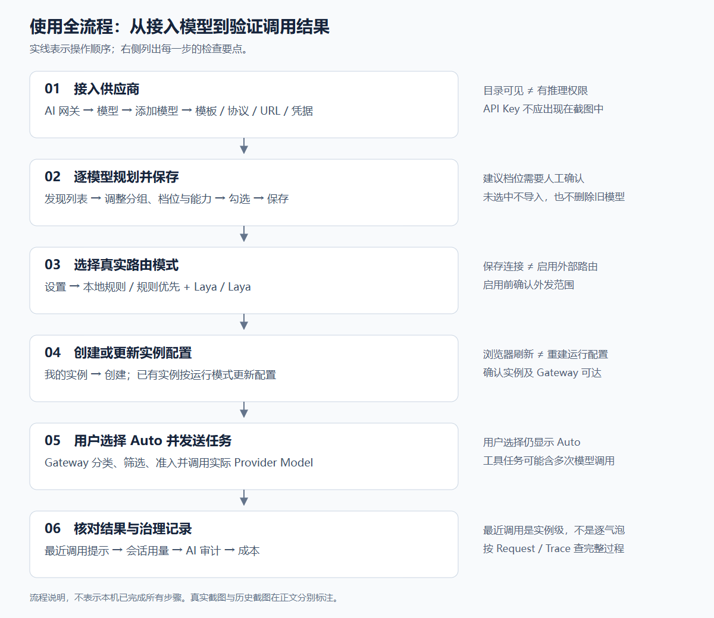

[打开可编辑 SVG](AIGateway/workflow-20261014/flow-01-user-journey.svg)

先完成管理员配置，再让用户通过实例使用 Auto。成功标准不是“保存按钮点过了”，而是模型保存成功、真实路由模式符合预期、实例请求确实进入 Gateway，并能够核对实际模型与调用记录。

## 3. Auto 与 Hybrid 的决策流程

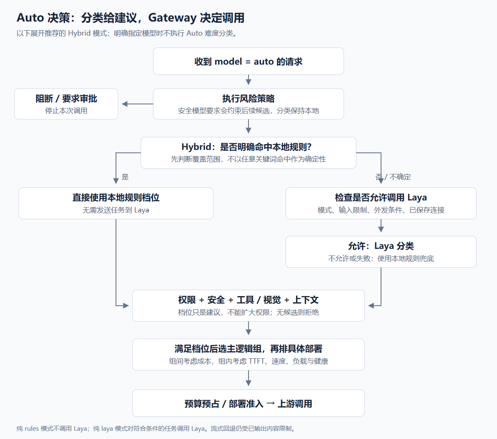

[打开可编辑 SVG](AIGateway/workflow-20261014/flow-02-auto-routing.svg)

这张图用于解释用户选择 Auto 后发生什么。Laya 只补充任务档位判断，不直接选择服务地址，不决定 Key 权限；本地规则兜底也不会放宽安全和上下文限制。

## 4. 调用治理与结算流程

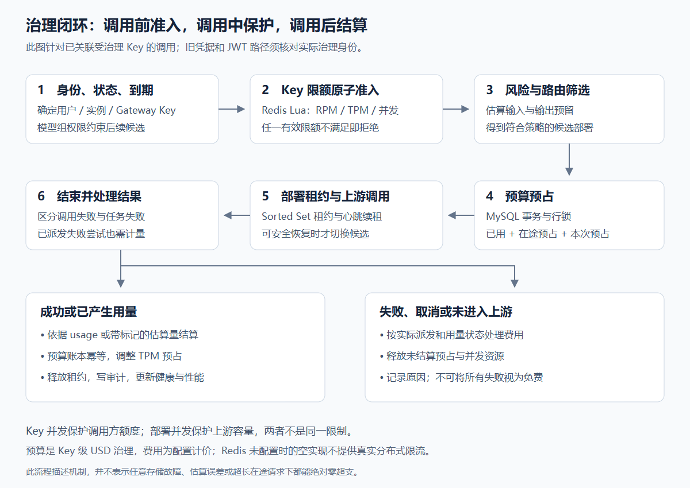

[打开可编辑 SVG](AIGateway/workflow-20261014/flow-03-governance.svg)

这张图对应受治理 Key 的调用。Key 额度与模型部署容量是两个层次，预算使用 MySQL 持久预占，限流及部署租约依赖 Redis 协调。失败后的计量取决于是否已派发及实际用量，不是统一退款或统一扣满预占。

## 5. 第一步：找到 AI 网关入口

入口：管理后台 → **AI 网关**，页面路径 `/admin/ai-gateway`。

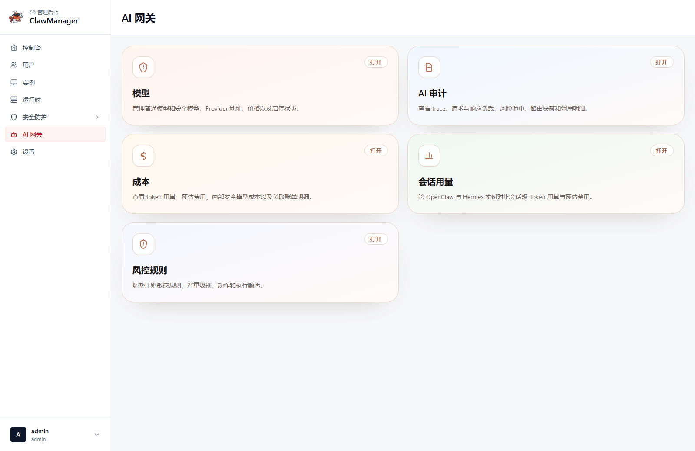

图 1 为本次实拍。这里的五个入口分别负责：

| 入口 | 操作内容 |
| --- | --- |
| 模型 | 接入供应商，维护模型能力与路由配置 |
| AI 审计 | 查看请求、路由、安全策略和错误证据 |
| 成本 | 按配置价格查看费用统计 |
| 会话用量 | 按会话、实例等维度查看 Token 使用情况 |
| 风控规则 | 维护放行、阻断或转向安全模型等规则 |

Laya 分类器配置不在这五张卡片中，需要进入左侧“设置”。不要在模型页面反复寻找分类器启用按钮。

## 6. 第二步：添加模型来源

入口：AI 网关 → 模型，页面路径 `/admin/models`。

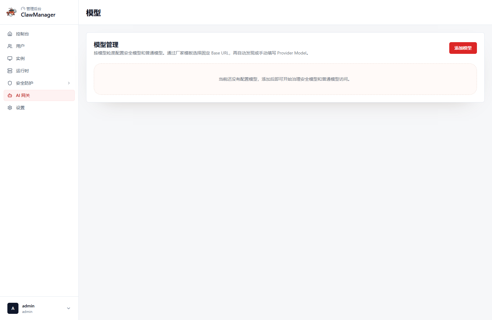

图 2 为本次真实空列表。点击右上角“添加模型”，进入配置表单：

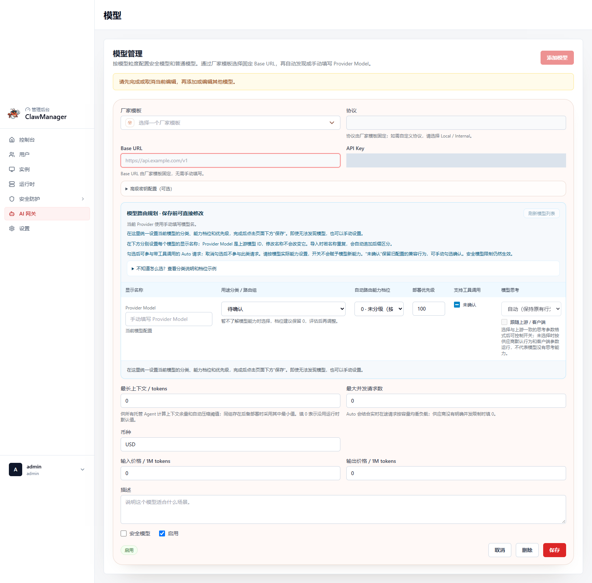

图 3 只打开了表单，没有保存或向供应商发起模型发现请求。操作时按以下顺序填写：

1. 选择厂商模板；使用自定义服务时选择相应的 Local / Internal 模板。
2. 确认协议与上游一致；不要把 OpenAI-compatible 和 Anthropic 参数格式混用。
3. 填写 Base URL 和 API Key；如已有 Secret 管理方式，可展开高级密钥配置填写 Secret Ref。
4. 使用“刷新模型列表”获取供应商暴露的模型目录；无法发现时，按实际情况手动填写 Provider Model。

验收点：目录中的模型 ID 与供应商提供的信息一致，发现错误有明确提示。拿到了模型列表只代表目录接口可用，不代表列表中的所有模型都拥有推理权限。

## 7. 第三步：在模型路由规划表中确认后保存

操作区域见图 3 中间的“模型路由规划 · 保存前可直接修改”。单模型和多模型配置都围绕此区域完成，避免把上游模型 ID、显示名称、路由组混淆。

| 表单位置 | 需要确认什么 | 常见误区 |
| --- | --- | --- |
| 显示名称 / Provider Model | 显示名称便于识别；Provider Model 必须是上游 ID | 只改显示名称不会改变上游模型 ID |
| 用途分类 / 路由组 | 同组模型应能承担相近的路由用途 | 这不只是列表标签，会影响逻辑路由 |
| 自动路由能力档位 | 建议值经人工确认，未知可保留 0 | 名称推断不是模型能力实测 |
| 部署优先级 | 值越小，静态优先级越高 | 不代表 Auto 完全忽略性能指标 |
| 支持工具调用 | 支持、不支持或未确认，按实际接口能力填写 | 勾选不会让模型自动获得工具能力 |
| 模型思考 | 选择匹配的控制协议，再决定是否允许开启 | 跟随上游不等于模型没有推理能力 |
| 最长上下文 / 并发 | 填上游真实限制；0 具有相应未知/不设限语义 | 不要用随意放大的数值消除报错 |
| 价格与币种 | 核对每百万 Token 单价，治理预算使用 USD | 价格 0 会参与零成本计算 |

发现多个模型后，逐行调整并只勾选需要保存的模型，再点击表单底部“保存”。未勾选项不导入，也不会因此删除已经保存的配置。保存后检查成功和失败条目，不要仅凭一个请求成功就认定全部保存成功。

本次环境没有模型来源数据，因此图 3 展示的是单条未保存表单，不是伪造的批量发现列表。批量勾选、发现后列表分组及真实保存结果，需要在配置有效供应商后补拍。

## 8. 第四步：配置分类器连接并选择路由模式

入口：管理后台 → **设置** → “自动路由分类器 · Laya 路由与对照”，页面路径 `/admin/settings`。

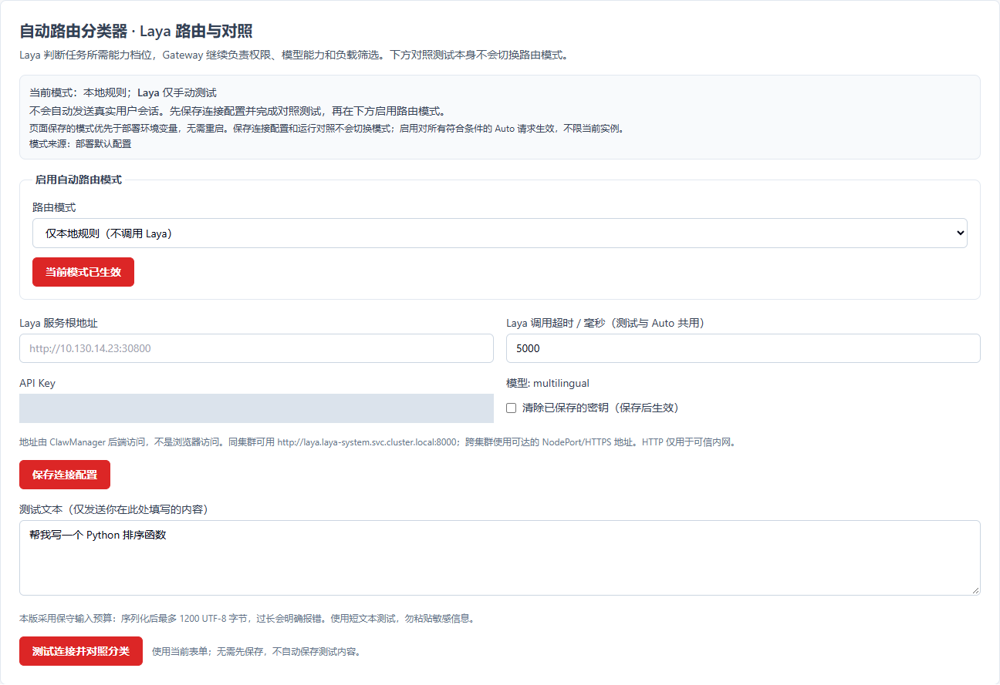

图 4 为本次实拍。读取页面顶部的“当前模式”和“模式来源”，才能确认后端实际采用什么模式；下拉框里暂时选中的值不等于已经生效。

如果只需要本地规则，可以保持当前模式，不需要配置 Laya。若要使用 Hybrid：

1. 配好后端服务端加密密钥，并确认各副本一致。
2. 填写后端可访问的 Laya 服务根地址、API Key 和超时时间。
3. 保存连接配置，确认提示成功。
4. 填写非敏感的短测试文本，点击“测试连接并对照分类”，比较规则、Laya 和 Hybrid 预览结果。
5. 在路由模式中选择“规则优先 + Laya”，阅读并确认允许外发的用户文本范围。
6. 点击对应的启用按钮，再核对顶部当前模式已经变为 Hybrid。

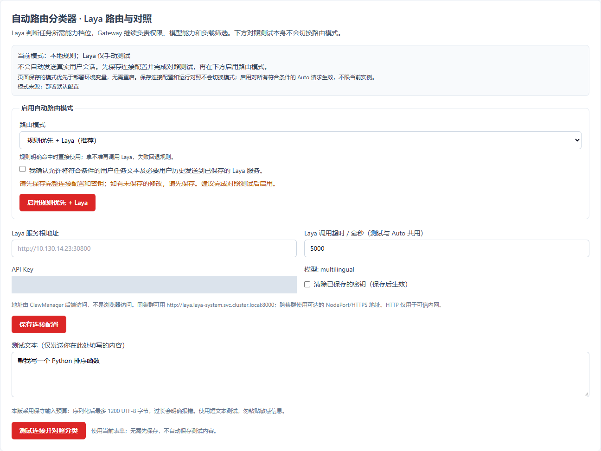

图 4B 仅演示按钮位置：本次没有勾选外发确认、没有保存连接、没有启用 Hybrid，也没有调用 Laya。因此它不能用作“Hybrid 已启用”的证据。

如果出现服务端加密密钥错误，应检查 `ROUTING_CLASSIFIER_ENCRYPTION_KEY`，不是不断更换 Laya API Key。连接测试成功也不会自动切换真实流量模式。

## 9. 第五步：进入或创建实例

入口：用户侧 → **我的实例**，页面路径 `/instances`。

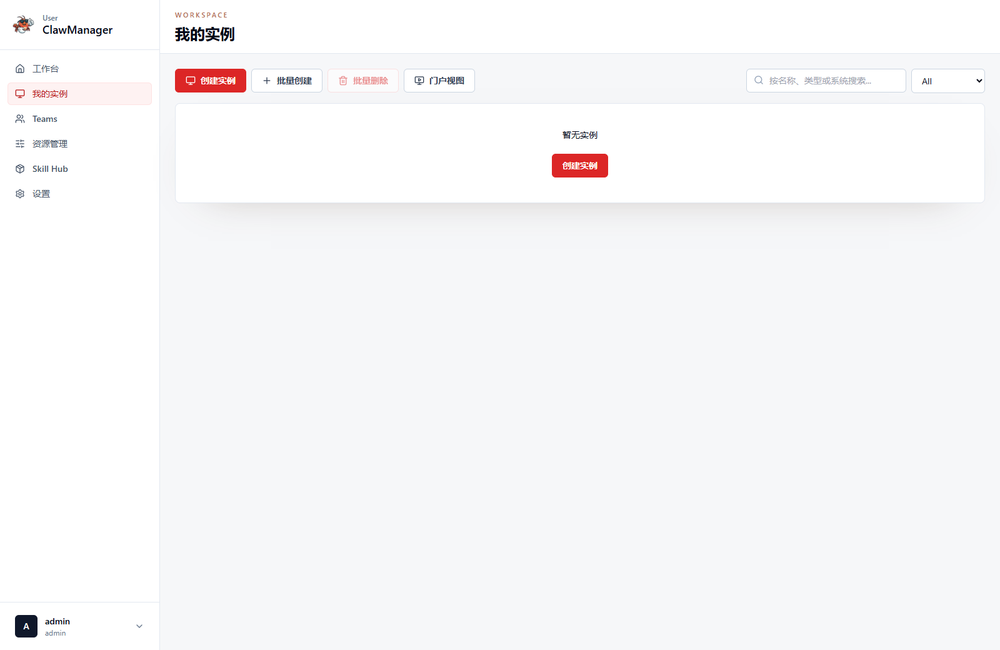

图 5 是当前真实状态。已有实例时进入对应实例；没有实例时使用创建入口，按平台配置选择运行模式和 Agent 类型。

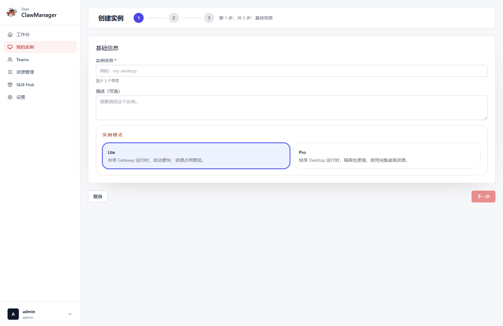

图 6 为本次实拍，未创建任何实例。实际操作前确认运行时镜像、资源和 Gateway 接入配置可用。实例创建后等待就绪，再打开内嵌 Agent 页面。

管理员调整模型后，Gateway 的当前候选与实例内展示目录是两个环节。仅刷新浏览器不代表重新下发模型配置；已有实例需要按其运行模式触发相应配置更新，并验证它实际接收到的模型列表。

## 10. 第六步：使用 Auto 并查看真实模型

操作：进入已就绪实例 → 在 Agent 的模型选择器中选择 `auto` → 发送测试任务 → 查看管理端工具栏的“最近回答 / 最近调用”。

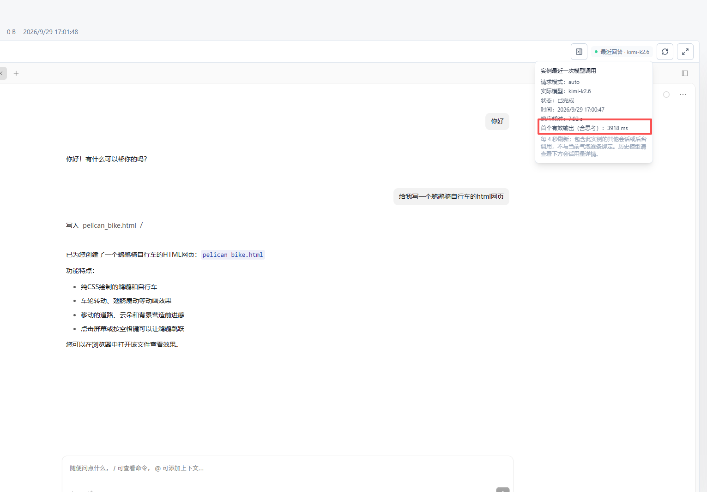

图 7 来源：用户此前提供的截图，界面时间为 **2026-09-29**。不是本次环境新产生的调用；其中模型名称和 `3918 ms` 仅属于那次历史记录，不能用于说明当前系统的性能。

阅读这类提示时，重点区分：

- 请求模式为 `auto`，实际模型是 Gateway 最终调用的 Provider Model。
- 提示位于 ClawManager 管理界面，不需要修改 OpenCode 自身 UI。
- 这是实例最近一次调用，可能属于其他会话或后台任务，不与当前气泡逐条绑定。
- 首个有效输出可包含思考或工具内容；一次写文件任务也可能产生多次模型请求。

当前本机没有实例，所以本次无法补拍新的 Auto 成功调用。正式演示时应补一张带当前日期和可关联 Request / Trace 的结果截图。

## 11. 第七步：查看会话用量

入口：AI 网关 → **会话用量**，页面路径 `/admin/session-usage`；实例页面也有对应的会话用量区域。

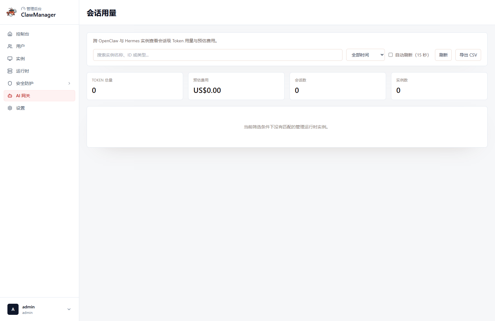

图 8 为本次实拍，不是一次真实调用后的统计结果。产生调用后，可按时间、用户、实例、Runtime、会话等页面提供的维度缩小范围，再查看 Token 与费用。

验收点：记录归属正确；一次包含多次模型调用的 Agent 任务不能只按最后一条调用计算全部用量。没有记录时应先确认请求是否真的经过平台 Gateway，而不是直接认定统计模块失效。

## 12. 第八步：查看 AI 审计并追踪路由

入口：AI 网关 → **AI 审计**，页面路径 `/admin/ai-audit`。

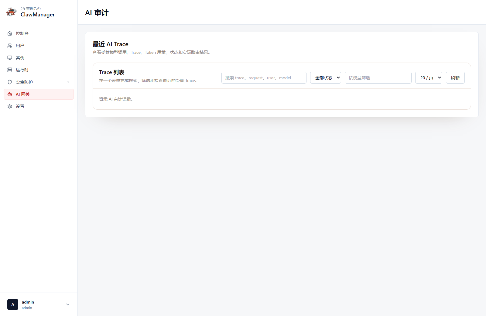

图 9 为真实空状态。实际调用后，以请求或 Trace 为线索核对：

1. 请求是否进入 Gateway，归属哪个用户、实例和 Key。
2. 是指定模型还是 Auto；分类来自规则、Laya 还是回退。
3. 所需档位、候选被淘汰的原因，以及最终部署。
4. 是否发生失败尝试、冷却或切换，最终结果是什么。
5. usage 是否来自上游，是否存在本地估算标记。

相关信息在后端审计事件及调用记录中保存；前端未展开或未直接展示的字段，应通过对应详情/API核对，不能声称每个字段都固定显示在列表列中。当前没有真实 Trace，因此本次未展示有数据的展开详情。

## 13. 第九步：核对费用与治理结果

入口：AI 网关 → **成本**，页面路径 `/admin/costs`。

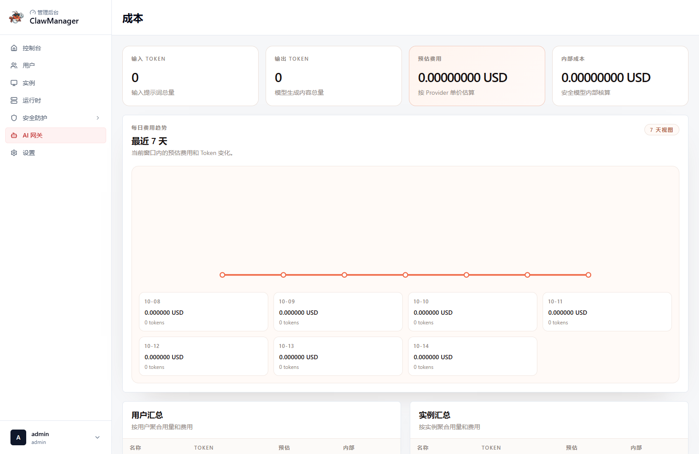

成本页面用于统计，不是完整 Virtual Key 管理页面。费用依据配置单价及 Token 用量计算，不能直接当作供应商账单，也不能由空页面推断预算预占已经验收。

验证 Key 治理还需要结合 [实现指南第 14 节“管理接口与部署前提”](aigateway-routing-governance_cn.md#14-管理接口与部署前提) 列出的管理 API：查看 Key 归属、模型组范围、RPM/TPM/并发和预算，再用受控测试请求核对准入拒绝、预占、结算及释放。当前没有完整 Key 前端，本指南不制作一个不存在的 Key 管理界面截图。

## 14. 可选配置：风控规则

入口：AI 网关 → **风控规则**，页面路径 `/admin/risk-rules`。

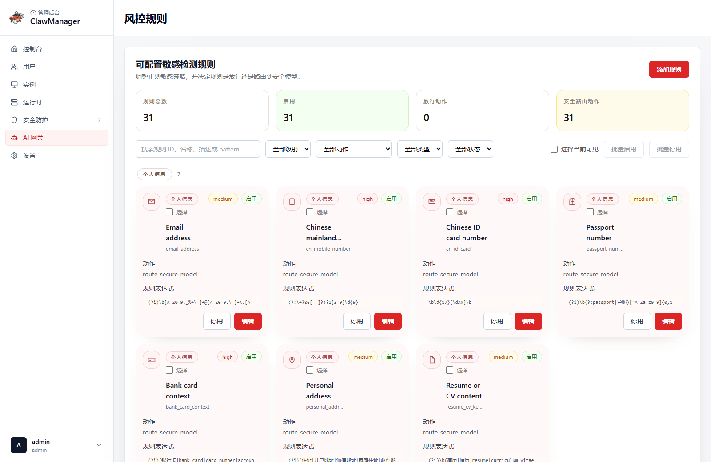

图 11 为本次实拍，未修改或测试规则。实际配置时确认命中动作是放行、阻断还是转向安全模型；规则顺序和启用状态会影响结果。安全模型转向仍要遵守相关权限和候选约束，不代表自动绕过模型组限制。

## 15. 图文覆盖与尚待补拍的证据

| 环节 | 本次材料 | 是否已完成真实业务验证 |
| --- | --- | --- |
| 管理端入口 | 当前实拍图 1 | 只验证页面可访问 |
| 模型配置与路由字段 | 当前实拍图 2、3 | 未保存，未调用供应商目录 |
| 多模型发现和批量保存 | 操作说明及流程图 | 尚无真实列表和保存结果截图 |
| 分类器连接、模式开关 | 当前实拍图 4、4B | 未保存、未启用、未运行对照 |
| 创建实例 | 当前实拍图 5、6 | 未创建或启动实例 |
| Auto 实际模型提示 | 用户历史截图图 7 | 只说明位置和含义，非本次验收 |
| 会话、审计和成本入口 | 当前实拍图 8、9、10 | 无新增调用，未验证统计闭环 |
| 风控管理入口 | 当前实拍图 11 | 未修改或测试规则 |
| Key 额度与预算治理 | 实现流程图和已有 API 索引 | 未进行额度、并发或结算测试 |

正式汇报时可使用三张流程图讲解全流程，再用实拍说明操作位置。需要证明“已经跑通”的部分，至少补齐发现与保存结果、Laya 对照与生效模式、一次当日 Auto 成功调用，以及能关联到该请求的用量和审计记录。

图像来源、重拍方式见 [图片目录说明](AIGateway/workflow-20261014/README.md)。

## 16. 图片识别与原生生图接口（新增，待部署验收）

本节说明新增代码的使用方式，不代表前述截图中的旧部署已经包含这些功能。当前自动化验证使用模拟上游；未进行真实供应商付费调用。

### 16.1 识图和生图是两种独立能力

“支持图片”表示聊天模型能够理解输入图片，不代表可以生成图片。在模型路由规划中，聊天模型的图片支持可手动确认；传图请求的显式选模、Auto 与候补模型仍受用户授权和图片输入能力约束。

生图模型需要选择“图片生成 / 编辑”类型，并分别打开生成或编辑能力。此类模型不会进入聊天 Auto 或实例聊天模型列表。原生 Images API 与 Responses 内置生图工具是不同调用链，当前实现前者，不能把聊天模型的工具调用开关当作已接入后者。官方协议说明见 [OpenAI Image generation](https://developers.openai.com/api/docs/guides/image-generation)。

### 16.2 管理员配置

1. 在模型路由规划中指定图片模型的显示名称、上游模型 ID 和 OpenAI/OpenAI-compatible 协议。Base URL 通常包含供应商的 API 前缀，例如 `/v1`，不要填到 `/images/generations`。
2. 按实际供应商能力开启“生成图片”和/或“编辑图片”，设置启用状态及可见用户。不同 URL 下的部署分别授权。
3. 配置“每张图片预算估算价（USD）”。留空会拒绝调用；明确填写 `0` 表示管理员认定免费。该价格独立于聊天输入/输出 Token 单价。
4. 此价格是平台预算估算，不是供应商账单，也不会随尺寸、质量或模型价格自动更新。应按允许使用的规格设置保守价格。
5. 使用 Virtual Key 时，Key 的模型组范围也必须包含此模型；RPM、TPM、Key 并发、模型部署并发和 Key 预算继续生效。

部署需执行图片相关迁移 `069`—`074`（以及已有的前置迁移），数据库记录模型能力、结果元数据、每对象加密密钥、持久化任务和分析快照，对象存储保存加密后的图片。多副本部署需要共享对象存储，不应使用各 Pod 独立的本地回退目录。数据库和对象存储应一起备份；丢失数据库中的加密密钥将无法恢复图片。

### 16.3 接口及调用示例

统一前缀为 `/api/v1/gateway/llm`，认证使用平台接受的用户 Token、实例 Token 或 Virtual Key，不是供应商 API Key。

| 接口 | 当前支持 |
| --- | --- |
| `POST /images/generations` | JSON 请求，显式模型或图片 Auto，非流式生成 |
| `POST /images/edits` | JSON 图片引用或 multipart 图片上传，显式模型或图片 Auto，非流式编辑 |
| `GET /images/artifacts/{artifact_id}` | 带认证的结果下载，重新校验授权和有效期 |
| `GET /images/requests/{request_id}` | 查询持久化任务状态、预算结算状态和当前可取回的图片 ID |

例如将以下 JSON 发送至 `/api/v1/gateway/llm/images/generations`，请求头包含 `Authorization: Bearer <平台凭证>`、`Content-Type: application/json` 和 `Idempotency-Key: <本次逻辑请求的唯一标识>`：

```json
{
  "model": "管理端配置的图片模型显示名称",
  "prompt": "画一只骑自行车的企鹅，简洁插画风格",
  "n": 1,
  "stream": false
}
```

上游必须返回 Base64 图片。对于默认返回 URL、但支持 `response_format` 的供应商，应显式传入 `"response_format":"b64_json"`；不要向不支持该参数的模型盲目添加它。当前 Gateway 不下载供应商输出的 URL。

编辑请求可使用 JSON：

```json
{
  "model": "管理端配置的图片模型显示名称",
  "prompt": "将背景改为蓝色",
  "images": [{"image_url": "data:image/png;base64,<图片内容>"}],
  "stream": false
}
```

multipart 编辑使用 `model`、`prompt`、`image`（多图使用 `image[]`）以及可选 `mask`，由客户端自动生成 multipart boundary。上游是否支持 JSON 编辑取决于该供应商的接口版本。

成功响应保留 `data[].b64_json`，并增加 `data[].artifact_id` 和顶层 `clawmanager` 估算说明。调用方可直接解码 Base64，或携带平台凭证下载 artifact；这不是可匿名打开的图片 URL。图片保存 7 天，过期立即禁止读取，后台定期清理。实例凭证和 Key 只能读取自身范围内的结果；所有者用户凭证可读取其名下结果，但仍需具有该模型的当前权限。

已协商严格治理协议的实例还必须携带原有任务、会话和运行时代际请求头；直接接入时不能通过生图接口绕过整轮取消要求。

### 16.4 限制、费用和失败排查

- 原生 Images API 支持显式模型及独立的图片 Auto（见 16.10）；不支持已固定任务的自动切换重做、流式生图、Files ID 解析、Responses 内置 `image_generation`。新版固定版本 OpenCode 补丁新增了 Agent 生图工具（见 16.7），尚未构建部署到运行中的实例；旧实例不会仅因后端升级就自动获得工具。
- 请求总量上限 32 MiB；输入图数量最多 16，单张上传沿用 5 MiB 限制；输出响应最多 64 MiB，单张结果最多 16 MiB，最大边长 8192、像素数不超过 32 Mi。实际供应商限制可能更小。
- TPM 准入使用平台估算：提示词 UTF-8 字节数 + 每张输入图 8192 + 每张请求输出图 32768。拿到有效上游用量后再调整；没有有效用量时保留估算，不伪造实际 Token。低 TPM Key 可能在调用前被拒绝。
- 预算按请求张数预占；正常返回按返回张数估算结算。明确的上游参数/权限/限流拒绝释放预占；超时、连接中断、无效成功响应等结果未知情形保留估算扣费。生成成功但保存失败也不会当作免费请求。
- Gateway 不自动重试，并向客户端发送 `x-should-retry: false`。提供相同 `Idempotency-Key` 和相同请求可防止重复提交再次生成，具体边界见下节。不传幂等键或换一个键属于新请求，仍可能重复生成和收费。
- 撤权会停止 Gateway 的在途请求并阻止结果返回，但无法保证供应商已经开始的计算被撤销或免单。提示词使用现有文本风控；尚未实现图片像素内容风控，不要将其视作已完成图片内容安全审核。
- 成功及进入执行阶段的失败响应带 `X-Trace-ID`。按该 ID 查询调用记录，图片流量标记为 `llm_image`；安全元数据包含错误码、供应商 HTTP 状态、是否发出请求、结果是否未知、估算费用及 artifact ID，不保存提示词、图片 Base64、签名 URL 或供应商错误原文。
- 已增加任务状态恢复和预算结算重试，但不等于供应商端严格一次执行或账单对账。调用日志与费用分析记录已支持持久化补写（见 16.9），TPM 用量的崩溃后补偿仍待实现；任务预算账本和分析报表不是同一个存储链路。不要将估算费用当成供应商实际账单。

### 16.5 幂等、断线和进程异常恢复

调用方应在**第一次发送之前**生成并保存一个幂等键，例如随机 UUID；同一次业务操作遇到网络断线时保留此键，不要自动换键重新生成。键限 200 个可见 ASCII 字符，不能含空格。Gateway 只存键的哈希，不将它转发给供应商。

幂等范围是“所有者用户 + 实例 + Gateway Key”。同一范围同一键只创建一个任务，数据库唯一约束处理多个 Pod 的并发请求；其他用户或 Key 可以复用相同的字符串，不会读到彼此的结果。请求指纹包含操作、请求字段、图片内容和运行时任务身份，不包含 multipart boundary 和上传文件名。

| 已有任务状态 | 再次提交同一请求的行为 |
| --- | --- |
| `preparing` / `running` | 返回 409 `image_request_in_progress`，不再次发送上游 |
| `completed` | 必要时重试预算结算及补写缺失的分析记录，读取已保存图片返回；不生成、不重复写费用记录 |
| `failed` / `unknown` | 返回 409 `image_request_terminal`，必须先核对状态，不自动重发 |
| 同键但请求内容不同 | 返回 409 `idempotency_conflict` |
| 图片过期或不可读取 | 返回 409 `image_result_unavailable`，不重新生成 |

重复请求仍需通过当前身份、模型授权、运行时任务检查和 Key 的请求准入，可能消耗一次 RPM。重放只返回已保存图片和用量；不保存或重放供应商的 `revised_prompt`，因此它不是原始响应字节级缓存。更改模型配置或撤权后也可能阻止重放。

响应中的 `X-Trace-ID` 即任务 ID，例如 `image_<32位十六进制随机值>`。携带同一平台凭证请求：

```http
GET /api/v1/gateway/llm/images/requests/image_<任务ID>
Authorization: Bearer <平台凭证>
```

响应示例：

```json
{
  "request_id": "image_<任务ID>",
  "state": "completed",
  "settled": true,
  "records_ready": true,
  "estimated_cost": 0.2,
  "artifact_ids": ["img_<图片ID>"]
}
```

查询也会检查模型当前权限。`artifact_ids` 只列出该范围内已保存且未过期的图片；`failed` 或 `unknown` 也可能存在部分图片，可逐个经下载接口取回。未上传完成的图片、只存在于退出进程内存中的结果无法恢复。若第一次断线未收到任务 ID，可用原请求和原幂等键再次提交以取得状态或 `X-Trace-ID`。

`records_ready` 表示调用与费用分析记录是否已提交，与 `settled`（Key 预算结算）独立。它仅出现在新版持久化快照的任务中；旧任务省略该字段，不应据此声称旧记录已经补齐。`completed` 同时 `records_ready=false` 表示生成结果已记录、分析记录仍待恢复，不表示需要重新生图。

后台恢复器在服务启动及随后每分钟运行。超过五分钟的 `preparing` 任务标为失败；超过五分钟的 `running` 任务标为结果未知并保留请求金额估算。恢复器**从不重新调用供应商**。预算预占切换为 `image_pending` 与任务进入运行态处于同一数据库事务，常规超时清理、预算周期切换和管理员预算重置不会释放这部分在途预占；终态写入后按原 reservation ID 幂等结算。

需要注意，数据库事务和外部 HTTP 发送不能组成同一个原子事务：如果进程在“已标记运行”之后、“真正发送”之前退出，也会保守标记 `unknown` 并保留估算。这种情况需要人工核对供应商账单，不应宣称一定已扣实际费用。图片结果保存七天，幂等任务记录目前不自动删除，避免图片过期后同一键意外再次生成；数据库容量需另行规划。

### 16.6 自动化验收边界

MySQL 授权、过期清理、并发幂等和预算恢复集成测试为显式启用：配置 `CLAWMANAGER_IMAGE_TEST_MYSQL_DSN`，数据库必须是空的、专用的 `clawmanager_test_images_` 前缀测试库；测试会创建并删除自己的测试表，不能指向业务库。未提供此独立测试库时测试跳过，不代表已验收数据库和对象存储联动。

可选的 MinIO 测试使用 `CLAWMANAGER_IMAGE_TEST_S3_ENDPOINT`、`CLAWMANAGER_IMAGE_TEST_S3_ACCESS_KEY`、`CLAWMANAGER_IMAGE_TEST_S3_SECRET_KEY`，只允许回环地址，自动创建带测试前缀的独立 bucket 并清理。不要填写业务 MinIO 地址或凭证。

2026-10-23 本地实际验证：MySQL 8.4.8 + 临时 MinIO，连续三轮通过。覆盖本地对象目录和 MinIO 两种存储、密钥原始二进制保存及日志脱敏、加密读写、授权隔离、过期删除、并发请求去重、预算预占跨周期/手工重置保留、模拟进程中断后的新工作实例恢复，以及并发结算只产生一条预算账本。该测试不访问真实模型供应商，不产生生图费用，也不代表所有 S3 实现或实例完整工具链均已验收。

### 16.7 Agent 生图工具接入（代码完成，待镜像与实例验收）

本轮在固定版本 OpenCode 2.0.27 的现有工具插件机制中注册五个工具，不修改 OpenCode 界面，也不新增直连供应商通道：

| 工具 | 作用 | Gateway 接口 |
| --- | --- | --- |
| `clawmanager_image_models` | 查询实例所有者及当前 Key 可用的生图模型、操作能力与管理员估算价格 | `GET /v1/images/models` |
| `clawmanager_generate_image` | 使用明确模型或图片 Auto 生成一张图片 | `POST /v1/images/generations` |
| `clawmanager_image_request_status` | 查询已有图片任务，不重新付费提交 | `GET /v1/images/requests/:requestID` |
| `clawmanager_save_image` | 将有权限读取的图片制品保存为工作区文件 | `GET /v1/images/artifacts/:artifactID` |
| `clawmanager_edit_image` | 读取工作区图片，支持可选 PNG 遮罩，提交单张结果的编辑请求 | `POST /v1/images/edits`（multipart） |

表中的 `/v1` 为 Gateway LLM 基础路径示例；实际 URL 为运行时已配置的 `CLAWMANAGER_LLM_BASE_URL` 加 `/images/...`，不要更改成供应商地址。

使用流程：管理员配置生图模型、用户授权、USD 单张估算价和 Key 预算 → 部署新版 Gateway 与已打补丁的 OpenCode 镜像 → 在受治理的 ClawManager 聊天模型会话中提出生图需求 → Agent 查询目录并选择支持生成的模型 → 按 OpenCode 当前权限策略确认工具调用 → Gateway 执行授权、任务状态、限流、预算和上游请求 → 返回任务 ID 与图片制品 ID → Agent 调用保存工具 → 用户在管理界面右侧 Workspace 中刷新并点击图片预览。

建议验收步骤（需要先部署补丁镜像，本次源码测试不等于已部署）：

1. 配置一个真实支持图片生成的模型；如需编辑，还要启用图片编辑能力。识图、生成和编辑是独立能力，不能互相替代。
2. 在新版受治理 OpenCode 实例中提出“生成一张图片，并保存为 `generated.png`”；按当前实例策略授权工具和文件写入。
3. Agent 应先查询图片模型目录，再生成并保存。保存返回前不能声称已经保存成功。结果不包含 Base64，也不要求用户手动拼接带凭据的下载链接。
4. 在右侧 Workspace 刷新，在当前 Agent 工作目录对应的文件夹（可能为 `project`）找到图片，点击预览或下载。复用管理端已有预览功能，不修改 OpenCode UI。
5. 提出“编辑 `generated.png`，把背景改为蓝色，另存为 `edited.png`”；Agent 选择有编辑能力的模型，经读取权限确认后上传图片。可选 `mask_path` 指向 PNG 遮罩，其透明区域表示待编辑区域。
6. 重复保存到同名文件应失败并要求换名；拒绝文件读取权限应不上传图片；撤销模型授权后，后续制品读取/编辑应拒绝。已经保存的本地副本不因撤权被删除。

编辑工具按 [OpenAI 官方图片编辑格式](https://developers.openai.com/api/docs/guides/image-generation#edit-images) 发送 `image[]` 与可选 `mask`；Anthropic 会话通过相同函数工具调用 Gateway，不假设 Anthropic 存在原生生图端点。

关键边界：

- 工具只对启用严格治理协议的新版 OpenCode 注册；仅在 `clawmanager` 提供方会话中展示。OpenAI Chat 和 Anthropic Messages 两种会话都使用同一工具执行链；这不是新增 Anthropic 原生生图端点，也不是 Responses 内置生图工具。
- 模型目录排除未启用、非图片模型、无操作能力、无有效 USD 估算价格、用户无权限或 Key 路由组不允许的模型。不返回供应商 URL、API Key 或用户授权名单。目录可用不保证供应商健康，执行前仍再次校验授权和全部治理条件。
- 工具使用运行时凭据，任务、会话、代际来自当前执行上下文，模型不能指定这些字段。权限拒绝时不发出生图请求；调用中的 HTTP 连接跟随任务中止。供应商已经完成的付费工作不能回滚。
- 幂等键由可信任务身份、运行时代际及工具调用 ID 生成。同一次工具执行重入使用相同键；新工具调用 ID 是新请求，不能把它当成免费重试。连接中断、结果未知时禁止自动重新提交，获得任务 ID 时先查询状态。
- 工具增加 `X-ClawManager-Image-Result: references`，仅返回受保护的图片引用，不把 Base64 和供应商重写提示词注入聊天上下文。未携带该头的原生客户端仍收到原有 Images JSON 响应。
- 保存需显式调用 `clawmanager_save_image`，不会把每个生成结果都自动落盘；制品通过 `/images/artifacts/:artifactID` 鉴权下载，仍检查所有者、Key 和模型权限。管理端已有 Workspace 图片预览可用，不新增 OpenCode 会话内预览。
- 本轮工具每次生成或编辑输出一张图片。编辑输入仅允许工作区普通 PNG/JPEG/WebP 文件，最多 16 张，每张及下载制品最多 5 MiB；图片与可选 PNG 遮罩总计最多 24 MiB。这是本地工具限制，不是所有供应商的统一上限。Gateway 继续校验图片内容、遮罩尺寸与模型能力。
- 文件路径必须相对当前工作区，父目录预先存在；拒绝越界、符号链接及保存到已有文件。复用 FileAccess/Environment/FileMutation 权限与读写机制，不绕过运行时文件权限。图片二进制不会进入工具结果/聊天上下文，但编辑时会上传到选定模型供应商。
- 下载完成后、写入前重新检查任务权限；下载被取消时不写入部分图片。已完成写入和供应商工作不能回滚。FileMutation 锁协调内部写入，不是防并发外部进程的操作系统级独占创建，也不保证文件写入期间崩溃的原子恢复。
- 旧 OpenCode、OpenClaw、Hermes 不会因本补丁自动获得这些工具。

验证记录：Gateway/Handler 回归、OpenCode 核心与测试类型检查通过；隔离 Bun 1.4.2 下工具测试覆盖目录与结果脱敏、稳定幂等键、权限拒绝、取消、撤权及 OpenAI/Anthropic 会话工具执行。新增真实临时工作区的“保存 → 带遮罩编辑 → 保存”流程，验证拒绝越界、符号链接、覆盖已有文件、超大文件、伪装图片和未授权读取。上述测试使用本地测试服务，不访问真实供应商，也不代表已运行实例已经验收。

2026-10-23 最新结果（含 16.10 的 Auto 扩展）：7 个图片工具测试（117 个断言）、12 个治理测试（49 个断言）全部通过。OpenAI/Anthropic 两种会话分别执行生成、保存、编辑；下载取消测试确认中断保持为取消状态且不产生部分文件。

### 16.8 尚未完成的计划项

- 其他运行时图片工具接入；已实现的 OpenCode 生成、编辑、工作区保存与管理端预览流程仍需真实实例端到端验收。OpenCode 会话内图片 UI 不在本轮修改范围。
- Responses 内置 `image_generation` 链路和流式图片事件；图片 Auto 第一版已实现（见 16.10）。
- 真实供应商账单对账；调用/费用分析记录的持久化补写已实现（见 16.9），不能据此推断真实账单金额。
- 真实供应商冒烟测试、实例端到端验收，以及新镜像构建和本机 K8s 更新。

后续实现继续复用本节的任务、授权、预算和结果存储，不另建绕过 Gateway 治理的付费调用通道。

### 16.9 图片调用与费用记录可靠补写

新增迁移 `074_add_image_analytics_outbox.sql`，在已有 `gateway_image_jobs` 中增加分析快照、终态快照和已补写标记，复用任务表作为持久化待办，不新增供应商调用通道。

1. 请求取得幂等任务时，同时保存服务端生成的所有者、实例/会话/Key、模型名称和脱敏操作元数据。快照不包含提示词原文、API Key、Base64 或图片 URL，恢复时不依赖后来修改或删除的模型配置。
2. 请求结束时，将终态、估算费用、图片引用、已知用量与耗时一并保存。即使随后分析表暂时无法写入，恢复所需数据仍在任务表。
3. 补写时锁定任务行，在一个事务中插入调用记录和需要的费用记录、关联二者并更新完成标记。费用写入失败会回滚调用记录；进程退出、重复恢复或多个副本并发处理，不会重复提交同一任务的这对记录。
4. 后台恢复器启动时及每分钟处理一批待补写记录，单批最多 100 条；失败的任务保留待办并后移，继续处理其他任务。完成任务的同键重放也会尝试补写，但绝不重发供应商请求。正常响应边界遇到补写失败返回 `image_record_pending` 和原任务 ID，应查询状态而不是换幂等键再次生成。
5. 在途进程崩溃且没有终态快照时，沿用 `unknown` 保守估算；标记 `recovered_without_final_outcome=true`，发送是否实际发生为未知，不捏造 Token 用量、完成时间或延迟。准备阶段崩溃记失败，不产生费用记录。

调用记录表示持久化的操作结果；Key 预算结算失败或分析记录延迟不会把已经生成成功的操作改写成供应商失败。两种持久化状态通过 `settled` 和 `records_ready` 分开表示。费用仍是管理员配置的单张估算价，`actual_cost` 保持空值；未知结果的实际扣费需要后续与供应商核对。

升级兼容：迁移为增量、可重复执行，旧任务默认不进入补写队列，避免旧版同步写入的记录被重复插入。不能恢复缺少快照的历史漏记；新旧服务混跑期间，旧服务创建的任务仍使用旧路径。应完成后端副本升级后再验收新恢复能力，不要求修改旧实例的接口配置。

验证：真实临时 MySQL 8.4.8 连续三轮通过，覆盖迁移重入、旧任务隔离、第二条记录写入失败的事务回滚、八路并发补写、进程重启模拟、准备/在途崩溃恢复、损坏快照不阻塞其他记录，以及现有预算幂等结算。Gateway 测试覆盖补写失败后的原键重放，确认只调用供应商一次、只结算一次且快照脱敏。本轮未更新业务数据库或 K8s 镜像，未进行真实供应商调用。

### 16.10 图片 Auto 路由（代码完成，待部署验收）

向图片生成或编辑接口传 `model: "auto"`，由 Gateway 选择一个有相应图片能力的部署。这里的 Auto **不是聊天 Auto**：不调用规则/Laya 分类器、不参考聊天能力档位，也不会把图片模型加入聊天模型列表。

选择顺序：

1. 按实例所有者过滤模型，再检查 Key 允许的路由组、模型启用状态、图片类型、当前生成/编辑能力及有效 USD 单张估算价。安全规则要求安全模型时，仅保留安全图片模型。授权检查异常不放行。
2. 读取共享部署状态，排除冷却中、并发已满和已有探测请求的半开部署。状态存储不可用时返回 `image_routing_unavailable`，不会绕过并发控制直连供应商。
3. 优先采用部署优先级数值较小的模型；同优先级结合近期图片完整请求耗时与当前在途负载排序。过期指标不继续使用；未知延迟按 30 秒排序基准处理，这不是供应商承诺耗时。没有使用聊天 TTFT 或每秒 Token 数预测图片耗时。
4. 分数相同时先比较单张估算价格；同价再用服务端随机请求 ID 打散选择。不是保证所有模型流量相等，也不保证总是选择最低价。生成/编辑、数量和尺寸不同可能影响耗时，本版不对每种参数建立独立性能桶。
5. 选定模型后仍需原子获取并发租约、预算预占、运行时任务绑定和再次授权检查。快照检查与实际获取之间容量可能变化；获取失败直接结束当前任务，不尝试切换部署。

共享健康/并发能力依赖已配置的 Redis 部署存储。未配置 Redis 而使用 Noop 存储时，只有静态候选与优先级/价格选择，没有真实在途指标或跨副本并发保证；生产验收应使用 Redis。

请求示例（路径以前述 Gateway 基础路径为准）：

```http
POST /api/v1/gateway/llm/images/generations
Authorization: Bearer <平台凭证>
Idempotency-Key: <为这一次图片操作生成并保留的唯一键>
Content-Type: application/json

{"model":"auto","prompt":"画一只蓝色小鸟","n":1}
```

编辑请求同样支持 `model=auto`，保留已有 JSON/multipart 输入格式，但只选择开启编辑能力的图片模型。尺寸、质量等供应商参数仍可能存在差异，本版不保证所有供应商接受同一组合；需要特定供应商功能时使用明确的模型名。

正常响应 `clawmanager` 字段增加 `routing_policy`、`selected_model` 和 `selected_model_id`。调用/审计记录同时保留请求的 `auto` 与实际模型。OpenCode 图片工具接受 `auto`，并把经过筛选的实际选模字段返回给 Agent；不返回 API Key 或供应商 Base URL。不在模型目录里增加一个虚构价格的 Auto 模型条目。

重试边界：同一所有者/实例/Key 范围内，幂等键命中已有任务时先读取原任务，**不重新运行 Auto 排序**；并发首次请求选择不同候选时，由数据库唯一键确定胜出的实际模型。重放时重新检查原模型的当前授权，原模型撤权或停用就拒绝，不改用其他可见模型。原任务已付费、失败或结果未知时不会自动切换供应商重做；上游错误仅影响后续新任务的健康排序。

健康反馈：原生图片调用会回写成功、总耗时及可处罚的上游失败；401/403 立即进入冷却，429、5xx 和非用户取消导致的异常反馈失败。图片存储故障或客户端取消不会单纯因此被当作供应商故障。预算金额仍按选中模型的管理员单张估算价计算，不是真实账单。

流式边界已按 [OpenAI 官方说明](https://developers.openai.com/api/docs/guides/image-generation#streaming) 核对：Image API 的部分图片事件与 Responses 的工具事件是不同格式，不能把非流式 JSON 响应包装后宣称支持流式。这两条流式/Hosted Tool 链路仍未实现，本版继续拒绝 `stream=true`。

本轮验证：后端权限/能力过滤、负载/健康排序、原模型撤权拒绝、排序服务异常时重放固定模型，以及上游失败不切换测试通过；真实临时 MySQL 的候选竞争与幂等范围隔离、预算/分析恢复连续三轮通过。OpenCode 核心和测试类型检查通过，7 个图片工具测试（117 个断言）与 12 个治理测试（49 个断言）通过。未调用真实供应商，未更新 K8s；部署后还需在真实实例验证选择结果和共享负载指标。
