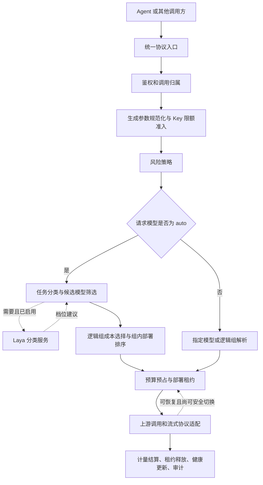

# ClawManager AI Gateway 扩展路由与治理能力说明

文档日期：2026-09-30

图文操作补充：2026-10-14。直接阅读 [第 18 节：操作全流程与界面截图](#gateway-operation-walkthrough)。

适用读者：产品、研发、测试、运维及技术评审人员

## 1. 文档范围

本文详细介绍 ClawManager AI Gateway 当前代码中的扩展路由与治理机制，包括模型配置、自动路由、规则与 Laya 分类、部署调度、故障切换、Virtual Key、限流、并发控制、预算和调用审计。

代码核查范围为 `D:\ClawManager` 的扩展工作区。该目录以 `7f8f1da` 为基础，包含尚未提交的修改和新增文件；因此本文不能视为该 Git 提交或主分支已经包含所有功能的证明。文档现保存于该项目的 `docs` 目录，文末源码路径均相对于项目根目录。

“已实现”表示可以在核查代码中找到对应实现，不表示当前 Kubernetes 镜像已更新、配置已启用或已经通过生产验收。技术说明主体形成于 2026-09-30；2026-10-14 增补了只读页面截图及操作说明，未重新验收全部实现，也没有执行真实模型调用、压力测试或部署操作。

ClawManager 使用自己的 Go Gateway 实现这些能力，借鉴了 LiteLLM 的分层路由、策略化凭据和调用治理思路，并没有将 LiteLLM Proxy 作为实际运行依赖。本文以本项目实现为准，不作为 LiteLLM 最新功能清单。

## 2. 能力总览

Gateway 的作用已经不只是转发 HTTP 请求，而是将模型调用分成四个相互衔接的部分：

1. **接入与身份识别**：统一协议入口，识别用户、实例或受治理 Key。
2. **路由决策**：判断任务需要的能力，筛选允许使用的模型，再选择具体部署。
3. **执行与保护**：限制频率、Token、并发及预算，处理协议、流式输出和可恢复故障。
4. **记录与反馈**：记录实际模型、耗时、用量和费用，并将部署表现用于后续调度。

| 能力 | 当前实现重点 | 关键边界 |
| --- | --- | --- |
| 模型目录 | URL 发现、元数据解析、分级建议、可编辑规划、勾选保存 | 目录发现不等于真实能力测评 |
| 逻辑模型组 | 将逻辑路由与上游部署分开 | 路由组不是纯展示标签 |
| Auto 路由 | 任务难度、权限、能力、上下文、成本等联合筛选 | 不是仅按模型名称或业务关键词直接匹配 |
| 分类器扩展 | 本地规则、Laya、规则优先的 Hybrid | 分类器给出档位，不决定权限和最终部署 |
| 性能调度 | TTFT、输出速度、总耗时、负载和健康评分 | 主要在同一逻辑组内比较，不保证全局最快 |
| 故障回退 | 候选部署切换、冷却、半开恢复、流式输出边界 | 已输出内容后不能任意透明重播 |
| Virtual Key | 模型组权限、生命周期、限额、预算和调用归属 | 保留旧凭据兼容路径；完整管理前端尚未形成 |
| 限流和并发 | Redis Lua 原子准入，Sorted Set 租约 | 依赖实际 Redis 配置，不是只填字段就生效 |
| 预算 | MySQL 事务预占、结算、账本和幂等处理 | 当前为 Key 级 USD 预算，不是完整层级预算 |
| 可观测性 | 请求模型与实际模型、审计、用量、费用和性能 | 最近调用不是逐气泡或整任务状态 |

模型代理、风险规则、基础费用和会话审计在原架构中已存在。本轮扩展是在这些基础上接入新的路由、Key 治理、状态协调和管理能力，而不是重新实现整个系统。

## 3. 架构与请求生命周期

### 3.1 组件职责

ClawManager 管理端负责配置和查看结果；Gateway 后端负责请求决策与执行；MySQL 保存持久业务数据；Redis 保存需要多副本共享的高频状态。

RuntimeAgent 在相应运行模式下负责承载实例进程、接收运行配置。它不是这套路由算法和 Key 预算的主体。Laya 是可选的外部分类服务，也不是实际为用户生成答案的聊天模型。



这是主要生命周期的概念图。实际代码中，预算控制器跨候选尝试复用，不能把回退理解成每次都重复创建同一份预算。

### 3.2 接口入口

| 路径 | 用途 |
| --- | --- |
| `GET /api/v1/gateway/llm/models` | 获取网关模型目录 |
| `POST /api/v1/gateway/llm/chat/completions` | Chat Completions 协议入口 |
| `POST /api/v1/gateway/llm/responses` | Responses 协议入口 |
| `POST /api/v1/gateway/llm/v1/responses` | Responses 兼容路径 |
| `POST /api/v1/gateway/llm/v1/messages` | Anthropic Messages 协议入口 |

三个生成协议入口先转换或归一到内部请求结构，再进入共同的 Gateway 服务。出站主要支持 OpenAI-compatible 和 Anthropic 两类协议适配；支持这些入口不意味着支持所有厂商 API、参数和多模态任务。

请求归属由鉴权上下文提供，包括用户、实例、Runtime、Gateway 和受治理 Key 等信息。治理逻辑不应依赖调用者自行填报一个可信的用户或实例身份。

## 4. 模型资源的组织方式

### 4.1 显示名称、逻辑组和 Provider Model

三个名称承担不同职责：

| 字段 | 含义 | 示例 |
| --- | --- | --- |
| `display_name` | 管理和选择时使用的名称 | `编程模型-主部署` |
| `model_group` | 可包含多个部署的逻辑路由名称 | `coding` |
| `provider_model_name` | 真正发给上游服务的模型 ID | `<供应商模型ID>` |

一条 `LLMModel` 记录表示一条具体上游部署配置。多条记录可以共享逻辑组，但拥有不同 URL、凭据、价格和优先级。

例如，客户端调用 `coding` 时，无需知道主部署和备用部署的实际 URL。Gateway 可以在该组内选择和切换。兼容旧配置时，没有组名的记录会以显示名称作为有效组名；明确匹配显示名称的解析优先于按组查找。

同一 URL 下的多个模型不一定属于同一路由组；不同 URL 的部署也可以属于同一组。页面的“按 URL 分组”是展示组织方式，与请求路由组不是一回事。

规划表中的“用途分类 / 路由组”会写入 `model_group`。把多条模型都放入 `general`，意味着允许它们参与这一逻辑路由，而不只是给它们贴上相同标签。

### 4.2 影响路由与治理的字段

| 字段 | 作用与约定 |
| --- | --- |
| `provider_type`、`protocol_type` | 选择厂商模板及协议适配逻辑 |
| `base_url`、`api_key`、`api_key_secret_ref` | 确定上游地址与凭据来源；Secret Ref 是引用已有 Secret 的方式 |
| `is_active` | 控制是否参与当前启用模型目录 |
| `is_secure` | 标记可供安全模型路由使用的配置，不是自动完成安全认证 |
| `quality_tier` | 模型能力档位，0～4 |
| `deployment_priority` | 静态顺序，数值越小越优先；Auto 动态排序也会考虑性能 |
| `context_window_tokens` | 声明可用上下文容量，0 表示未知/沿用运行时默认语义 |
| `max_concurrent_requests` | 该部署的并发上限，0 表示不设该上限 |
| `tools_support_override` | 管理员对工具支持的三态声明：支持、不支持、未确认 |
| `supports_tools`、`supports_vision`、`capability_source` | 自动发现或保存的能力元数据及其来源 |
| `reasoning_enabled`、`reasoning_control_mode` | 是否允许思考及采用什么协议开关 |
| `input_price`、`output_price`、`currency` | 每百万 Token 的输入输出单价和币种 |

档位约定如下：

| 档位 | 含义 |
| --- | --- |
| 0 | 未分级；当前 Auto 按基础 1 档兼容并记录提示 |
| 1 | 简单任务 |
| 2 | 通用任务和常规编程 |
| 3 | 复杂任务和多约束设计 |
| 4 | 严密推理、证明或形式化论证 |

档位是平台路由契约，不是供应商统一认证的能力评分。档位 4 不等于必须打开思考输出；开启思考也不会把模型自动提升为 4 档。

### 4.3 发现、规划与批量保存

后端使用 URL 和凭据查询供应商模型目录，解析已支持的分页和元数据格式，生成标准化模型条目。名称规则可以识别部分模型家族、轻量、编码、推理和非聊天任务特征；元数据可以补充上下文及工具等信息。

管理员在规划表内逐项确认显示名称、路由组、能力档位、优先级、工具支持和思考设置，然后勾选需要保存的模型。未勾选项不导入，不等于删除已有模型；删除是独立操作。刷新同一来源时，已手动编辑的规划字段会尽量保留。

批量保存接口支持逐项成功/失败结果，不是整个列表的一次全有或全无事务。模型数量多时，不能仅凭一个成功 HTTP 状态就认定所有行均已保存。

未知模型保留待确认分类，不通过模型名称臆测高档能力。名称规则和供应商元数据都不是实际推理测试；当前没有自动对所有发现模型运行能力基准，也没有用 Laya 给每个供应商模型评级。

## 5. Auto 内容路由

### 5.1 三层决策

一次 Auto 请求需要回答三个不同问题：

1. 任务需要什么能力：分类器输出 `RequiredTier`。
2. 哪些模型允许且能够承担任务：Gateway 执行权限和能力约束。
3. 最终调用哪条部署：成本选组，组内依据状态选择具体部署。

因此，分类器不是模型列表查询器，不能通过返回一个高档位绕过用户权限，也不能直接将请求发给未配置的外部模型。

### 5.2 风险处理优先于外部任务分类

Gateway 先执行现有风险规则。拦截和要求审批的动作在当前请求路径中阻止调用；要求安全模型的动作将候选限制到符合条件的安全模型。允许动作不应误解为自动强制使用安全模型。

对于被要求安全路由的请求，任务分类保持本地处理，不向外部分类型适配器发送文本。该保护依赖风险规则识别，不能保证所有未知敏感信息都被自动识别。

### 5.3 候选过滤

当前 Auto 过滤条件及常见诊断原因包括：

| 条件 | 淘汰原因示例 |
| --- | --- |
| 模型未启用 | `inactive` |
| Key 不允许访问该组 | `key_not_allowed` |
| 协议或返回数量不兼容 | `unsupported_protocol_or_completion_count` |
| 请求带工具，模型被明确判为不支持 | `tools_not_supported` |
| 请求有图像，现有能力元数据不支持 | `vision_not_supported` |
| 治理预算币种不兼容 | `budget_currency_mismatch` |
| 请求必须使用安全模型 | `secure_model_required` |
| 能力档位不足 | `insufficient_quality_tier` |
| 声明的上下文容量不足 | `context_capacity_exceeded` |

工具支持的“未确认”保留兼容语义，不会仅因名称规则没有识别到工具能力就一律排除。声明支持也不是实际能力证明，上游仍可能拒绝工具参数。

上下文判断使用完整请求的估算输入和输出预留，而不是只计算最后一句用户文本。容量填 0 会保留未知语义并产生提示，不构成已知的容量保护。

### 5.4 档位不足时如何降级

Gateway 先确定满足其他约束的候选，再考虑任务档位。如果没有模型达到所需档位，会选择其他约束仍然满足的最高可用档位，并记录 `insufficient_quality_tier_best_available`。

降级仅调整能力档位，不放开 Key 权限、安全、协议和上下文等限制。若所有候选均不符合硬约束，就返回 `no eligible model for automatic routing`，而不是随便选一个模型。

### 5.5 估算成本与逻辑组选择

模型调用的配置成本按下式估算：

```text
预计费用 = 预计输入 Token × 输入单价 / 1,000,000
         + 预留输出 Token × 输出单价 / 1,000,000
```

满足条件的模型按逻辑组组织，使用组内优先顺序确定的代表配置参与组间成本比较，再选择主组。随后组内部署可能因负载和健康发生调整，因此不能把代表配置的费用视为最终账单保证。

只有币种可比较时才直接比费用；混合币种没有自动换汇，而是采用确定性顺序并记录提示。单价填 0 会作为零成本参与决策，不等于“未知价格”。

用户明确指定显示名称或逻辑组时，不执行 Auto 任务难度分类；仍需经过身份和风险处理及相应治理。不能将 Auto 的全部候选过滤细节未经核查就泛化为所有显式路由完全相同的行为。

## 6. 可替换分类器与 Laya

### 6.1 分类器接口

内部通过 `RoutingClassifier` 接口接入分类器，核心方法是：

```go
Classify(ctx context.Context, input RoutingClassificationInput) (RoutingClassification, error)
```

输入最多包含最近 8 轮用户文本，用于理解当前任务及“继续”“按前面的要求”等指代。系统提示词、工具定义、工具结果、凭据和模型权限不是此接口的任务输入。

输出包括所需档位，可选评分或置信信息，以及简短的信号和警告。档位必须为 1～4；规则评分不是统计置信度。

分类器由服务构造及配置逻辑接入，不是允许管理员上传任意代码的动态插件系统。运行器包含超时、并发及异常结果保护。分类失败可以回退本地规则；调用方主动取消时不应继续调用上游来“补救”。

### 6.2 本地规则

本地分类结合意图、常规编程、复杂约束、证明要求等信号，同时处理材料引用、否定表达和上下文延续。其目标是估计完成任务需要的最低能力，而不是简单看到“代码”就选择最高档。

用于 Hybrid 的明确规则覆盖与一般难度评分相互区分：前者返回 `matched`、`ambiguous`、`unmatched`，后者给出难度建议。非零规则分数不代表已经有足够把握跳过 Laya。

目前明确覆盖包含问候、简单算术、特定常规小函数等窄任务模式；复合任务、依赖上下文或存在歧义的输入更保守。

### 6.3 三种运行模式

| 模式 | 实际 Auto 请求行为 |
| --- | --- |
| `rules` | 使用本地规则；手动对照功能仍可调用 Laya |
| `hybrid` | 明确命中规则直接使用，否则尝试 Laya，失败回退规则 |
| `laya` | 对符合条件的请求使用 Laya，失败回退规则 |

保存的页面模式优先于 `CLAWMANAGER_ROUTING_CLASSIFIER` 部署默认值。后续请求读取模式、地址和凭据的一致配置快照；已在途请求可能按旧快照完成，不会在流式输出中途切换分类器。

连接保存、手动测试、模式启用是三个独立动作。保存连接或点击对照不会自动把真实用户会话发送到 Laya。启用外部模式需确认允许发送符合条件的用户任务文本及必要历史。

### 6.4 Laya 调用和提示词

适配器使用 Bearer 鉴权调用 Laya `/v1/systemone`，模型固定为 `multilingual`。版本化提示词让它在 simple、medium、complex、reasoning 四档之间选择，不生成用户答案。

提示词强调按实际交付要求判断：常规函数、网页、局部修错属于通用档；跨模块和多约束联动才属于复杂档；严密证明和非平凡推导才属于推理档。不应仅因术语多、文本长或用户强行指定档位而提高等级。

当前配置超时范围为 100～30000 毫秒；序列化任务输入使用 1200 UTF-8 字节的保守预算。历史可因预算被舍弃，最后一条任务超限等情况会走诊断及回退路径，不是无限上下文或任意静默截断。

设置服务共享外部分类调用槽位，限制单个后端进程内的并发，避免慢分类占满请求处理资源。该限制不是跨所有 Gateway 副本的全局 Laya 限额。

### 6.5 配置安全与对照

Laya API Key 以 AES-GCM 加密后保存，配置查询只返回是否已保存密钥。加密使用服务端密钥，优先来自 `ROUTING_CLASSIFIER_ENCRYPTION_KEY`，代码保留符合要求的 JWT Secret 兼容来源。实际部署应配置独立、随机、至少 32 字符的密钥，并保持各副本一致。

服务端加密密钥和 Laya API Key 是两回事。前者缺失或不符合要求时，重新填写后者不能解决保存失败。

手动对照发送本次填写的测试内容，展示规则与 Laya 的档位、耗时和诊断，并可预览 Hybrid 的处理选择。规则分数、Laya 概率分布和置信信息不等于已验证的准确率；需要使用人工标注的实际业务样本评测。

## 7. 部署级性能调度

### 7.1 观测数据

每个物理部署维护共享状态，包括：

- 当前在途请求数 `Inflight`。
- 首个有效输出耗时 `EWMATTFTMs`。
- 调用总耗时 `EWMALatencyMs`。
- 输出速度 `EWMATokensPerSecond`。
- 样本数、连续失败次数、最近成功/失败时间。
- 健康状态与冷却截止时间。

这些观测来自调用反馈，而不是每次收到请求先对全部模型做一次主动探测。Redis 状态不需要保存用户提示词来完成负载协调。

### 7.2 评分方式

当前实现先估计输出长度，并计算：

```text
基础预测时间 = 历史 TTFT + 预计输出 Token / 历史 TPS × 1000

若有历史总耗时：
预测时间 = 0.7 × 基础预测时间 + 0.3 × 历史总耗时

最终评分 = 预测时间 × 负载惩罚 × 健康惩罚
```

评分越低通常越优先。预计输出长度由预留输出量推导并限制在一定范围内，不直接将全部最大输出上限当作每次都会生成的长度。缺少样本时使用冷启动估计值，不把未知部署视为零耗时。

有配置容量时，负载惩罚考虑在途量与容量的比例；未配置容量时，也根据在途请求数量增加惩罚。退化、半开和未知状态有不同健康惩罚。

历史性能使用指数加权移动平均：样本较少时更快响应，样本积累后更平滑。超过 5 分钟没有相应新观测的部分状态会按未知处理，并清除排序时使用的陈旧性能值；这与 Redis 数据本身的存储 TTL 不是同一概念。

### 7.3 近似性能带与稳定选择

代码在最佳评分约 20% 的性能带中选取候选，通过用户、会话和 10 分钟时间桶形成稳定哈希，再做双候选比较。这样既减少同一会话在性能相近部署间频繁切换，也避免始终集中到排序第一条。

对于缺少样本的部署，哈希条件保留少量探索机会，条件比例设计约为 1/20。这不是对每个用户或每段实际流量都保证精确 5% 配额。

### 7.4 调度范围

Auto 仍优先保留内容与成本选出的主逻辑组，在逻辑组及安全属性边界内做性能排序，再追加符合策略的其他组作为可用性回退。

当前不等于“所有不同模型统一按响应速度全局排序”。一个组只有一个可用部署时，无法通过组内负载均衡得到另一个更快部署，也没有实现每个用户独立的公平排队或响应时间服务等级保证。

## 8. 并发租约、健康状态和故障切换

### 8.1 部署并发保护

部署调用前通过 Redis Lua 检查冷却状态和并发容量，并在 Sorted Set 中创建租约。租约分数代表到期时间；当前租约时长为 4 分钟，运行期间每分钟续租，结束后主动释放。

Acquire 会清理过期成员，异常退出留下的租约不需要永久手工清理。容量为 0 表示不设置部署上限，但在正常 Redis 路径下仍可记录在途量用于调度。

释放租约优先于保存性能反馈，避免已完成的请求因为指标写入较慢而继续占用稀缺容量。

### 8.2 健康状态

主要状态包括 unknown、healthy、degraded、cooldown 和 half_open。可归因于部署的失败累积后进入冷却；当前连续失败阈值为 3 次，冷却基准时间为 30 秒。被识别的模型权限拒绝可立即冷却。

冷却结束后的 Acquire 转为半开，只允许一个在途探测请求。成功后恢复健康；失败则继续退化或冷却。在冷却刚建立时，此前已在途请求稍后成功不会立即错误地清除冷却。

下游断开、调用者取消或明显的请求问题不应统一视为供应商故障；代码在健康反馈中区分是否需要惩罚部署。

### 8.3 故障候选与权限边界

系统对部分上游限流、服务异常、认证/资源异常和明确的模型权限拒绝支持回退。是否继续尝试由错误类型、候选集合和流式提交状态共同决定，不是所有 HTTP 错误都无限重试。

候选仍须遵守其适用的逻辑组、安全和调用策略。ClawManager 自己拒绝某个 Key 的权限，与供应商拒绝某条部署使用指定模型，是不同层级的问题，不能借故障回退绕过本地权限。

### 8.4 流式切换边界

流式调用需要区分“上游连接已建立”和“客户端已经收到不能撤回的内容”。Gateway 对前导数据做有限缓冲，在安全条件满足时允许切换；一旦文本、推理或工具相关有效内容已经提交，就不能透明地重发完整请求。

这既防止重复文本，也避免一个工具调用被错误执行两次。流中途失败可能需要由 Agent 或用户决定重试，不能以“自动故障切换”承诺无条件恢复所有流式请求。

## 9. Virtual Key 与身份治理

### 9.1 凭据类型和兼容路径

`GatewayAuth` 当前接受：

1. 用户访问 JWT。
2. 数据库中的受治理 Gateway Key。
3. 兼容的实例生命周期 Token。

受治理 Key 包括托管实例、用户创建和服务用途等类型，关联用户或实例，并设置状态、过期时间、允许的模型组、RPM、TPM、并发和预算。

新凭据格式以 `cmk_live_` 开头，另有稳定的 `gk_` 公共标识。`gateway_keys` 保存 HMAC-SHA256 摘要而不是新凭据明文；密钥材料优先使用 `GATEWAY_KEY_PEPPER`，再兼容 `JWT_SECRET`。生产环境不能依赖开发默认值。

变更加盐密钥会改变凭据摘要结果，不能像普通展示参数一样随意修改；应按凭据迁移或轮换进行协调。

### 9.2 权限和生命周期

Key 的模型权限按逻辑组校验，组名比较不区分大小写。当前允许组列表为空表示未设置该项限制，不代表“禁止所有模型”。

过期、禁用或撤销的 Key 不允许使用。普通 Key 轮换只替换凭据材料，保留数据库行、公共标识、已有预算和归属。托管实例 Key 不能通过普通手动撤销/轮换接口直接处理，需要与实例生命周期协调，避免实例继续携带失效凭据。

启动装配中有托管实例 Key 的补建入口，保持与原实例凭据机制衔接；实际补建成功与否仍应看运行结果。

### 9.3 治理覆盖条件

只有鉴权上下文存在受治理 Key 身份时，Handler 才挂接对应 Key 的限流参数和预算控制器。用户 JWT 或尚未进入治理记录的兼容路径，不自动具有另一把 Key 的限制。

因此，要验证“某个实例受到预算和并发保护”，应检查实际请求归属，而不能只检查系统里是否存在一条 Key 记录。

后端已提供管理员 Key 管理 API；本次核查未发现完整的前端自助 Key 管理页面。这部分应按“治理后端和管理 API 已实现”理解。

## 10. Key 级限流与并发控制

### 10.1 三种不同约束

| 约束 | 限制对象 | 示例含义 |
| --- | --- | --- |
| RPM | 某个 Key 的每分钟准入请求数 | 一分钟最多接受指定数量请求 |
| TPM | 某个 Key 的每分钟 Token 计量窗口 | 预占输入和输出额度，完成后调整 |
| 并发 | 某个 Key 的同时在途请求数 | 前一批未完成时限制新请求进入 |

Key 并发保护调用方配额，部署并发保护上游容量，二者不能相互替代。多个 Key 可能共享同一部署，一个 Key 也可能调用多个部署。

### 10.2 原子准入过程

Lua 脚本使用 Redis 时间判断当前分钟窗口，并执行：

1. 读取 RPM、TPM 当前窗口计数。
2. 清理并发 Sorted Set 的过期租约。
3. 先检查本次请求是否会超过任意有效限额。
4. 全部允许后，才增加计数并写入并发租约。

避免“请求因 TPM 或并发被拒绝，却已经消耗 RPM”的部分更新问题。窗口是按 Redis 时钟划分的固定分钟窗口，不是精确滑动窗口限流。

TPM 先按估算量预占，调用结束后根据用量差额调整；旧窗口完成的请求不会把差额错误加到新窗口。未完成结算的释放路径可退还对应 Token 预占，并发租约则释放。RPM 不能被理解为总会随任何失败退款。

超限由 Handler 返回 429，并设置 `Retry-After: 60`。这是一致的限流提示，不是并发槽位实际释放时间的精确预测。

### 10.3 Redis 异常策略

配置了 Redis 且有效限额需要访问存储时，如果准入存储不可用，返回 503 `rate_limit_store_unavailable`，不直接绕过 Key 配额。

但未配置 Redis 时，程序会装配 Noop Store，不执行真实分布式限流。限额均为 0 的请求也可能直接通过而无需访问限流存储。部署验收需要确认配置、实际请求和异常行为，不能只查看数据库字段。

## 11. 预算、成本和 Token 计量

### 11.1 生成参数与预占口径

Gateway 统一处理输出上限相关字段并校验生成数量。未指定输出上限时，当前默认值为 4096 Token，该值用于预占并下发到对应上游请求，避免只在预算中估算却没有约束出站参数。

输入估算考虑消息、工具定义、结构化响应参数和原始请求的相关规模，不使用各供应商精确 tokenizer。Token 估算是容量及预算近似值，不能作为真实计费绝对值。

### 11.2 预算预占与账本

Key 支持累计、每日、每周、每月预算。持久控制位于 MySQL，而不是 Redis。

预占时通过事务和 `FOR UPDATE` 锁定相关 Key 预算状态，判断：

```text
已结算费用 + 其他有效预占 + 本次预计费用 <= 预算上限
```

请求有多个可能回退的部署时，当前预占估算会考虑所有候选可能消耗的输入费用之和，加上候选中最大的输出预留费用，避免只按最便宜的一次尝试预占。候选较多时，这种做法可能比较保守。

预占记录当前初始有效期为 10 分钟。完成结算时，写入以 reservation ID 为标识的账本，并处理预占和累计花费；待结算记录支持恢复处理，重复结算避免重复加账。过期或释放机制减少异常退出留下的占用，但不能据此承诺任意长请求或持续数据库故障下绝对零超支。

### 11.3 费用示例

以下仅解释计算口径，不是实际运行结果：

- 输入单价为 1 USD/百万 Token，输出单价为 2 USD/百万 Token。
- 本次估算输入 2000 Token，明确设置输出上限为 1000 Token。
- 单候选预占为 `2000 × 1 / 1000000 + 1000 × 2 / 1000000 = 0.004 USD`。
- 若有两个同价回退候选，则该估算为两次输入加一次最大输出，即 `0.006 USD`。

最终结算使用观测到的用量及实际尝试处理结果；不是预占多少就固定扣多少。已经派发的失败尝试也有用量/费用记录和累计处理，不能把失败自动等同为免费。

### 11.4 币种与准确性

治理预算当前仅支持 USD。存在预算控制器时，非 USD 模型会受到币种约束，即使预算上限不是一个较小的正数，也不能直接假设允许混用币种。

上游未返回完整 usage 时使用本地估算，并记录 `gateway.usage.estimated`。平台费用依据配置单价，不等于供应商发票金额；实际折扣、缓存计价、特殊推理计费等不能在没有对应适配时被默认视为精确复现。

当前实现不是完整的组织、团队、用户和 Key 多层叠加预算，也不通过在生成过程中随时截断流来保证预算毫无误差。

## 12. 安全、工具和思考适配

### 12.1 风险治理

Gateway 复用现有风险检测服务、风险命中记录和安全模型路由。风险事件与请求、用户、实例等信息关联，便于追踪为什么被拦截或转向其他模型。

可替换分类器接口不等于可插拔 Guardrail 框架；目前不能据此宣称已实现第三方护栏生态、完整输入输出内容治理或审批工作流闭环。

### 12.2 工具调用

工具支持字段用于候选筛选，协议适配负责工具定义和工具调用数据的传递。真正执行文件写入、命令或其他动作的通常是 Agent，而不是模型路由器。

因此，“支持工具调用”不是完整 MCP 治理能力。工具注册、工具级权限、逐工具审批、工具执行预算等，需要另外的实现依据。

### 12.3 思考控制和展示

不同上游使用不同参数，例如 `thinking.type`、`enable_thinking`、`chat_template_kwargs.enable_thinking` 或厂商专用设置。Gateway 根据配置和适配逻辑选择写法，清理互相矛盾的开关，并结合管理员允许值和请求意图控制。

推理片段的流式解析和协议转换已有对应处理，但最终是否显示取决于三件事：上游确实产生并返回相应字段，Gateway 正确转发，Agent 客户端选择展示。不能用打开一个复选框承诺所有模型都会输出思考文本。

### 12.4 上下文与 Agent

最长上下文用于 Auto 容量过滤，也进入实例启动配置生成。逻辑路由多个候选容量均已知时采用保守值；有未知容量则保留未知语义。

模型配置更新、Gateway 每次请求选模、实例内模型目录刷新是不同环节。实例启动/重建配置会读取相关模型信息，但仅刷新浏览器不等于重新生成运行时配置。是否所有 Agent 都使用该上下文值调整自动压缩，应分别验证对应 Runtime 和 Agent 的消费逻辑。

## 13. 审计与可观测性

### 13.1 调用记录

`model_invocations` 将请求模型与实际 Provider Model 分开记录。用户请求仍可以是 `auto`，后端记录则能展示真实调用了哪个模型。

记录还包含用户、实例、会话、请求、Trace、Runtime、Gateway Key、输入输出 Token、耗时、状态和错误。成本和审计数据关联这些标识，用于把选择、失败尝试和最终结果串起来。

常见事件包括请求接收/完成/失败、风险命中、路由选择或拒绝、部署选择、故障切换、预算拒绝和用量估算。排查时应结合一次请求的完整记录，而不是只取最新一条失败。

### 13.2 指标口径

| 指标 | 解释 | 注意事项 |
| --- | --- | --- |
| TTFT | 上游调用开始到首个有效输出 | 可包含推理或工具内容，不等于用户看到正文的时间 |
| 调用耗时 | 单次模型请求或尝试的执行耗时 | 不代表整个多轮 Agent 任务 |
| Generation 时长 | 根据调用阶段及首个有效输出计算 | 包含传输等影响，不是纯 GPU 生成时间 |
| TPS | 输出量与生成阶段时长的比值 | 用量估算和网络回压会影响结果 |
| 分类耗时 | 分类器或对照记录中的开销 | 不是完整 DNS、TLS、工具、前端分段追踪 |

TTFT 的起点在上游调用阶段，因此不能直接把其数值当作包含鉴权、数据库和 Laya 分类的完整用户等待时间。

### 13.3 实例管理端展示

ClawManager 管理界面通过 `InstanceModelHint` 显示最近调用/回答的实际模型、状态和耗时，约每 4 秒刷新。它不改变 Agent 中用户选择的 `auto`，也不需要修改 OpenCode 本身的 UI。

该提示是实例级最新调用，可能来自其他会话或后台请求，不与当前气泡逐条绑定。一次尝试失败不一定表示整个任务失败；一次回答成功也不证明后续工具链已完成。历史情况应查看会话用量及审计详情。

## 14. 管理接口与部署前提

### 14.1 主要管理 API

下表路径均相对于 `/api/v1`，并受对应管理员鉴权保护。

| 接口 | 用途 |
| --- | --- |
| `GET /admin/models`、`PUT /admin/models` | 查询及保存模型 |
| `POST /admin/models/discover` | 模型发现 |
| `POST /admin/models/batch` | 批量保存，返回逐项结果 |
| `DELETE /admin/models/:id` | 删除模型配置 |
| `GET/POST /admin/gateway-keys` | 查询或创建受治理 Key |
| `POST /admin/gateway-keys/:id/rotate` | 轮换适用类型的 Key |
| `PATCH /admin/gateway-keys/:id/limits` | 修改频率与并发限额 |
| `PATCH /admin/gateway-keys/:id/budget` | 修改预算 |
| `GET /admin/gateway-keys/:id/usage` | 查询预算使用情况 |
| `POST /admin/gateway-keys/:id/revoke` | 撤销适用类型的 Key |
| `GET/PUT /system-settings/routing-classifier` | 查询或保存分类器连接 |
| `PUT /system-settings/routing-classifier/mode` | 显式修改真实路由模式 |
| `POST /system-settings/routing-classifier/compare` | 分类测试和对照 |

### 14.2 关键配置

| 配置 | 用途 | 部署注意事项 |
| --- | --- | --- |
| MySQL 与数据库迁移 | 配置、Key、预算、调用记录持久化 | 镜像代码和数据库结构必须配套 |
| `GATEWAY_RATE_LIMIT_REDIS_URL` | Key 限流及部署状态协调的优先 Redis 地址 | 未设置时回退 Runtime Redis 配置；均无配置时使用空实现 |
| `GATEWAY_KEY_PEPPER` | 新治理凭据 HMAC 密钥材料 | 各副本一致；变更须考虑旧凭据校验 |
| `ROUTING_CLASSIFIER_ENCRYPTION_KEY` | Laya 凭据加密 | 独立随机密钥，至少 32 字符，各副本一致 |
| `CLAWMANAGER_ROUTING_CLASSIFIER` | `rules`、`hybrid`、`laya` 的部署默认模式 | 页面已保存的模式优先 |
| Laya URL/API Key/超时 | 外部分类型服务连接 | 地址由后端访问，不是浏览器直接访问 |

页面模式变化用于后续请求，不要求重启；更改部署环境变量和服务端密钥通常需要重启相应后端。不要把两者混为一谈。

### 14.3 存储故障处理差异

| 故障 | 当前主要策略 |
| --- | --- |
| Key 限流 Redis 准入失败 | 有效约束依赖存储时返回服务不可用，不静默放行 |
| 部署状态 Redis 失败 | 倾向继续静态候选调用；失去正常的性能/容量协调保证 |
| Laya 超时、忙碌或返回无效 | 记录诊断并回退本地规则，调用方已取消除外 |
| 分类模式配置读取失败 | 分类路径使用相应回退处理，不表示整个数据库功能仍可用 |
| 预算预占数据库失败 | 不能安全获得预占时阻止进入上游，不当作预算无限 |
| 结算或审计持久化失败 | 有错误记录及部分恢复机制，仍需运维关注数据完整性 |

Redis 不是简单的“有就加速、没有也完全等价”。尤其不能在使用空实现时宣称分布式并发和限流已经生效。

## 15. 一次完整的 Auto 请求示例

假设管理员已保存以下条件：有可用的 2 档编程模型组、正确的工具能力和上下文配置；组中有两条可用部署；调用者使用有权访问该组的治理 Key；Hybrid 已启用且 Redis 正常。

用户发送“帮我写一个 Python 排序函数”，客户端请求模型为 `auto`。以下是机制演示，不是实测记录：

1. Gateway 验证 Key 状态及归属，提取模型组权限和限额。
2. 规范化生成参数，估算 Token，通过 Key 的 RPM、TPM 和并发准入。
3. 风险策略允许继续处理。
4. 窄规则命中常规小型函数任务，给出 2 档；本次跳过 Laya。
5. Gateway 检查模型权限、协议、工具和上下文，淘汰不满足要求的候选。
6. 根据组代表配置的估算费用选择主组，再结合 TTFT、速度、负载和健康排序部署。
7. 完成预算预占并取得具体部署租约。
8. 将 `auto` 替换为真实 Provider Model，按适配协议发起上游调用。
9. 如发生可恢复错误且尚未输出不可撤回内容，尝试符合策略的备选。
10. 完成后结算用量与费用、释放租约、更新健康及性能观测，保存调用和审计。
11. 用户仍看到模型选择为 Auto；管理端最近调用提示可以展示实际模型。

如果改为没有明确规则覆盖的复合任务，第 4 步会尝试 Laya。即使 Laya 返回更高档位，也仍然必须执行第 5 步及后续治理，不会直接越过权限调用任意模型。

## 16. 常见现象与排查顺序

| 现象 | 可能所在环节 | 优先检查 |
| --- | --- | --- |
| `no eligible model for automatic routing` | Auto 候选过滤 | 启用状态、Key 组权限、工具/视觉声明、上下文、币种及安全要求 |
| `gateway deployment is unavailable` | 所有可尝试部署无法准入 | 冷却、半开、并发容量和候选数量 |
| 429 `rate_limit_exceeded` | Key 准入 | RPM、TPM、并发哪个约束命中，不要只反复重试 |
| 503 `rate_limit_store_unavailable` | Key 协调存储 | Redis 连接与运行状态 |
| `gateway key budget exceeded` | 预算预占 | 已用金额、在途预占、价格、输出上限和回退候选规模 |
| 提示加密密钥未配置 | 分类器设置持久化 | 服务端加密配置，不是模型 API Key 文本框 |
| 对照成功但 Auto 没用 Laya | 模式或 Hybrid 明确命中 | 保存模式、模式来源、规则覆盖结果、安全路由限制 |
| 模型支持思考但界面不展示 | 请求控制、上游返回或客户端展示 | 分别确认出站参数、返回字段、协议转换和 Agent 设置 |
| 最近调用显示失败但有答案 | 尝试级或后台调用记录 | 同一 Trace/Request 的完整过程，以及提示是否来自其他会话 |
| 回复慢但 TTFT 不高 | 生成、工具执行或多轮请求 | 输出长度、思考、工具耗时、重试和整任务调用次数 |

排查应先定位请求或 Trace，再查看分类结果、候选淘汰、部署尝试和结算记录。只凭聊天界面的单个状态通常无法确认根因。

## 17. 当前边界与后续验证重点

代码已有较完整的路由与调用治理主流程，但不能将其描述为完整复刻 LiteLLM。以下能力尚不能从当前实现推出：

- 全部模型之间统一按最快响应排序，或对每个用户提供严格公平调度。
- 基于 Embedding 的语义路由、语义缓存和自学习选模。
- 对发现的所有模型自动完成真实能力评级。
- 完整组织/团队/用户/Key 叠加预算及所有币种自动转换。
- 完整自助 Virtual Key 管理界面。
- 通用第三方 Guardrail 插件生态及 MCP 工具级治理。
- 所有供应商、所有协议扩展和全部推理模式的无差别兼容。
- 逐聊天气泡的精确模型关联，以及覆盖工具和前端的完整耗时追踪。

正式验收需要分别证明：配置真实生效、多副本限流不穿透、预算重复结算不重复扣费、故障切换不跨权限边界、流式输出不重复、Laya 回退可用、未知能力处理合理，以及客户端确实消费了所下发配置。

源码有相应路由、分类器、Key、预算、Redis、协议和前端测试文件，但本次没有重新执行这些测试。性能和降本收益需要固定样本集、相同配置下的前后对照，不能仅凭实现了指标采集就宣称已有明确改善比例。

<a id="gateway-operation-walkthrough"></a>

## 18. 操作全流程与界面截图

独立阅读版：[ClawManager AI Gateway 操作全流程与界面截图](aigateway-operation-guide_cn.md)。

这一节按实际使用顺序说明“在哪里操作、需要填写什么、如何判断是否成功”。前面的章节介绍实现机制，本节用于上手操作和汇报演示。

### 18.1 截图范围与阅读方式

本次新截图来自 2026-10-14 本机 `https://localhost:30443` 的真实页面，不是绘制的界面原型。截图时管理员可见模型列表为 0 条，“我的实例”为空，分类器当前显示本地规则模式；本次没有添加业务数据来制造成功结果。

- 新截图只涉及页面访问、打开未保存表单及改变尚未提交的选择，不保存模型、不启用外部路由、不创建实例、不运行模型或 Laya 测试。
- API Key 输入区域采用实心遮罩；遮罩不代表原本已经填写密钥。
- “实例实际模型提示”使用你此前提供的 2026-09-29 历史截图，图下注明来源，不作为当前本机调用成功的证据。
- 没有真实数据的环节保留空状态，并写明后续验证标准。特别是多模型发现结果、Laya 对照结果和新调用的审计明细，本次未实测生成。

流程图同时提供 PNG 与可编辑 SVG，Markdown 预览不支持 Mermaid 时也能直接查看。图片使用相对路径；分享文档时需要保留 `docs/AIGateway/workflow-20261014/` 目录。

### 18.2 使用全流程


[打开可编辑 SVG](AIGateway/workflow-20261014/flow-01-user-journey.svg)

先完成管理员配置，再让用户通过实例使用 Auto。成功标准不是“保存按钮点过了”，而是模型保存成功、真实路由模式符合预期、实例请求确实进入 Gateway，并能够核对实际模型与调用记录。

### 18.3 Auto 与 Hybrid 的决策流程


[打开可编辑 SVG](AIGateway/workflow-20261014/flow-02-auto-routing.svg)

这张图用于解释用户选择 Auto 后发生什么。Laya 只补充任务档位判断，不直接选择服务地址，不决定 Key 权限；本地规则兜底也不会放宽安全和上下文限制。

### 18.4 调用治理与结算流程


[打开可编辑 SVG](AIGateway/workflow-20261014/flow-03-governance.svg)

这张图对应受治理 Key 的调用。Key 额度与模型部署容量是两个层次，预算使用 MySQL 持久预占，限流及部署租约依赖 Redis 协调。失败后的计量取决于是否已派发及实际用量，不是统一退款或统一扣满预占。

### 18.5 第一步：找到 AI 网关入口

入口：管理后台 → **AI 网关**，页面路径 `/admin/ai-gateway`。


图 1 为本次实拍。这里的五个入口分别负责：

| 入口 | 操作内容 |
| --- | --- |
| 模型 | 接入供应商，维护模型能力与路由配置 |
| AI 审计 | 查看请求、路由、安全策略和错误证据 |
| 成本 | 按配置价格查看费用统计 |
| 会话用量 | 按会话、实例等维度查看 Token 使用情况 |
| 风控规则 | 维护放行、阻断或转向安全模型等规则 |

Laya 分类器配置不在这五张卡片中，需要进入左侧“设置”。不要在模型页面反复寻找分类器启用按钮。

### 18.6 第二步：添加模型来源

入口：AI 网关 → 模型，页面路径 `/admin/models`。


图 2 为本次真实空列表。点击右上角“添加模型”，进入配置表单：


图 3 只打开了表单，没有保存或向供应商发起模型发现请求。操作时按以下顺序填写：

1. 选择厂商模板；使用自定义服务时选择相应的 Local / Internal 模板。
2. 确认协议与上游一致；不要把 OpenAI-compatible 和 Anthropic 参数格式混用。
3. 填写 Base URL 和 API Key；如已有 Secret 管理方式，可展开高级密钥配置填写 Secret Ref。
4. 使用“刷新模型列表”获取供应商暴露的模型目录；无法发现时，按实际情况手动填写 Provider Model。

验收点：目录中的模型 ID 与供应商提供的信息一致，发现错误有明确提示。拿到了模型列表只代表目录接口可用，不代表列表中的所有模型都拥有推理权限。

### 18.7 第三步：在模型路由规划表中确认后保存

操作区域见图 3 中间的“模型路由规划 · 保存前可直接修改”。单模型和多模型配置都围绕此区域完成，避免把上游模型 ID、显示名称、路由组混淆。

| 表单位置 | 需要确认什么 | 常见误区 |
| --- | --- | --- |
| 显示名称 / Provider Model | 显示名称便于识别；Provider Model 必须是上游 ID | 只改显示名称不会改变上游模型 ID |
| 用途分类 / 路由组 | 同组模型应能承担相近的路由用途 | 这不只是列表标签，会影响逻辑路由 |
| 自动路由能力档位 | 建议值经人工确认，未知可保留 0 | 名称推断不是模型能力实测 |
| 部署优先级 | 值越小，静态优先级越高 | 不代表 Auto 完全忽略性能指标 |
| 支持工具调用 | 支持、不支持或未确认，按实际接口能力填写 | 勾选不会让模型自动获得工具能力 |
| 模型思考 | 选择匹配的控制协议，再决定是否允许开启 | 跟随上游不等于模型没有推理能力 |
| 最长上下文 / 并发 | 填上游真实限制；0 具有相应未知/不设限语义 | 不要用随意放大的数值消除报错 |
| 价格与币种 | 核对每百万 Token 单价，治理预算使用 USD | 价格 0 会参与零成本计算 |

发现多个模型后，逐行调整并只勾选需要保存的模型，再点击表单底部“保存”。未勾选项不导入，也不会因此删除已经保存的配置。保存后检查成功和失败条目，不要仅凭一个请求成功就认定全部保存成功。

本次环境没有模型来源数据，因此图 3 展示的是单条未保存表单，不是伪造的批量发现列表。批量勾选、发现后列表分组及真实保存结果，需要在配置有效供应商后补拍。

### 18.8 第四步：配置分类器连接并选择路由模式

入口：管理后台 → **设置** → “自动路由分类器 · Laya 路由与对照”，页面路径 `/admin/settings`。


图 4 为本次实拍。读取页面顶部的“当前模式”和“模式来源”，才能确认后端实际采用什么模式；下拉框里暂时选中的值不等于已经生效。

如果只需要本地规则，可以保持当前模式，不需要配置 Laya。若要使用 Hybrid：

1. 配好后端服务端加密密钥，并确认各副本一致。
2. 填写后端可访问的 Laya 服务根地址、API Key 和超时时间。
3. 保存连接配置，确认提示成功。
4. 填写非敏感的短测试文本，点击“测试连接并对照分类”，比较规则、Laya 和 Hybrid 预览结果。
5. 在路由模式中选择“规则优先 + Laya”，阅读并确认允许外发的用户文本范围。
6. 点击对应的启用按钮，再核对顶部当前模式已经变为 Hybrid。


图 4B 仅演示按钮位置：本次没有勾选外发确认、没有保存连接、没有启用 Hybrid，也没有调用 Laya。因此它不能用作“Hybrid 已启用”的证据。

如果出现服务端加密密钥错误，应检查 `ROUTING_CLASSIFIER_ENCRYPTION_KEY`，不是不断更换 Laya API Key。连接测试成功也不会自动切换真实流量模式。

### 18.9 第五步：进入或创建实例

入口：用户侧 → **我的实例**，页面路径 `/instances`。


图 5 是当前真实状态。已有实例时进入对应实例；没有实例时使用创建入口，按平台配置选择运行模式和 Agent 类型。


图 6 为本次实拍，未创建任何实例。实际操作前确认运行时镜像、资源和 Gateway 接入配置可用。实例创建后等待就绪，再打开内嵌 Agent 页面。

管理员调整模型后，Gateway 的当前候选与实例内展示目录是两个环节。仅刷新浏览器不代表重新下发模型配置；已有实例需要按其运行模式触发相应配置更新，并验证它实际接收到的模型列表。

### 18.10 第六步：使用 Auto 并查看真实模型

操作：进入已就绪实例 → 在 Agent 的模型选择器中选择 `auto` → 发送测试任务 → 查看管理端工具栏的“最近回答 / 最近调用”。


图 7 来源：用户此前提供的截图，界面时间为 **2026-09-29**。不是本次环境新产生的调用；其中模型名称和 `3918 ms` 仅属于那次历史记录，不能用于说明当前系统的性能。

阅读这类提示时，重点区分：

- 请求模式为 `auto`，实际模型是 Gateway 最终调用的 Provider Model。
- 提示位于 ClawManager 管理界面，不需要修改 OpenCode 自身 UI。
- 这是实例最近一次调用，可能属于其他会话或后台任务，不与当前气泡逐条绑定。
- 首个有效输出可包含思考或工具内容；一次写文件任务也可能产生多次模型请求。

当前本机没有实例，所以本次无法补拍新的 Auto 成功调用。正式演示时应补一张带当前日期和可关联 Request / Trace 的结果截图。

### 18.11 第七步：查看会话用量

入口：AI 网关 → **会话用量**，页面路径 `/admin/session-usage`；实例页面也有对应的会话用量区域。


图 8 为本次实拍，不是一次真实调用后的统计结果。产生调用后，可按时间、用户、实例、Runtime、会话等页面提供的维度缩小范围，再查看 Token 与费用。

验收点：记录归属正确；一次包含多次模型调用的 Agent 任务不能只按最后一条调用计算全部用量。没有记录时应先确认请求是否真的经过平台 Gateway，而不是直接认定统计模块失效。

### 18.12 第八步：查看 AI 审计并追踪路由

入口：AI 网关 → **AI 审计**，页面路径 `/admin/ai-audit`。


图 9 为真实空状态。实际调用后，以请求或 Trace 为线索核对：

1. 请求是否进入 Gateway，归属哪个用户、实例和 Key。
2. 是指定模型还是 Auto；分类来自规则、Laya 还是回退。
3. 所需档位、候选被淘汰的原因，以及最终部署。
4. 是否发生失败尝试、冷却或切换，最终结果是什么。
5. usage 是否来自上游，是否存在本地估算标记。

相关信息在后端审计事件及调用记录中保存；前端未展开或未直接展示的字段，应通过对应详情/API核对，不能声称每个字段都固定显示在列表列中。当前没有真实 Trace，因此本次未展示有数据的展开详情。

### 18.13 第九步：核对费用与治理结果

入口：AI 网关 → **成本**，页面路径 `/admin/costs`。


成本页面用于统计，不是完整 Virtual Key 管理页面。费用依据配置单价及 Token 用量计算，不能直接当作供应商账单，也不能由空页面推断预算预占已经验收。

验证 Key 治理还需要结合第 14 节列出的管理 API：查看 Key 归属、模型组范围、RPM/TPM/并发和预算，再用受控测试请求核对准入拒绝、预占、结算及释放。当前没有完整 Key 前端，本节不制作一个不存在的 Key 管理界面截图。

### 18.14 可选配置：风控规则

入口：AI 网关 → **风控规则**，页面路径 `/admin/risk-rules`。


图 11 为本次实拍，未修改或测试规则。实际配置时确认命中动作是放行、阻断还是转向安全模型；规则顺序和启用状态会影响结果。安全模型转向仍要遵守相关权限和候选约束，不代表自动绕过模型组限制。

### 18.15 图文覆盖与尚待补拍的证据

| 环节 | 本次材料 | 是否已完成真实业务验证 |
| --- | --- | --- |
| 管理端入口 | 当前实拍图 1 | 只验证页面可访问 |
| 模型配置与路由字段 | 当前实拍图 2、3 | 未保存，未调用供应商目录 |
| 多模型发现和批量保存 | 操作说明及流程图 | 尚无真实列表和保存结果截图 |
| 分类器连接、模式开关 | 当前实拍图 4、4B | 未保存、未启用、未运行对照 |
| 创建实例 | 当前实拍图 5、6 | 未创建或启动实例 |
| Auto 实际模型提示 | 用户历史截图图 7 | 只说明位置和含义，非本次验收 |
| 会话、审计和成本入口 | 当前实拍图 8、9、10 | 无新增调用，未验证统计闭环 |
| 风控管理入口 | 当前实拍图 11 | 未修改或测试规则 |
| Key 额度与预算治理 | 实现流程图和已有 API 索引 | 未进行额度、并发或结算测试 |

正式汇报时可使用三张流程图讲解全流程，再用实拍说明操作位置。需要证明“已经跑通”的部分，至少补齐发现与保存结果、Laya 对照与生效模式、一次当日 Auto 成功调用，以及能关联到该请求的用量和审计记录。

图像来源、重拍方式见 [图片目录说明](AIGateway/workflow-20261014/README.md)。

## 附录：实现索引

以下路径相对于 `D:\ClawManager`。同一单元格中未重复目录的文件位于前一个文件的同级目录。

| 主题 | 源码 |
| --- | --- |
| 服务装配、API、Redis 与分类器配置 | `backend/cmd/server/main.go` |
| 鉴权与请求归属 | `backend/internal/middleware/auth_middleware.go` |
| 协议入口、限额准入 | `backend/internal/handlers/ai_gateway_handler.go`、`ai_gateway_protocol_handler.go` |
| 请求准备、出站、流式处理、计量 | `backend/internal/aigateway/service.go` |
| 模型字段与思考协议 | `backend/internal/models/llm_model.go`、`llm_reasoning.go` |
| 模型发现与保存 | `backend/internal/services/llm_model_service.go` |
| 模型管理与批量保存 API | `backend/internal/handlers/llm_model_handler.go` |
| 内容路由和候选淘汰 | `backend/internal/aigateway/content_router.go` |
| 任务规则、接口和 Hybrid | `backend/internal/aigateway/routing_difficulty.go`、`routing_classifier.go`、`hybrid_classifier.go` |
| Laya 调用与分类提示词 | `backend/internal/aigateway/laya_classifier.go`、`laya_prompt.go` |
| 分类器设置与运行模式 | `backend/internal/aigateway/classifier_settings.go`、`laya_live_classifier.go` |
| 部署排序和权限错误识别 | `backend/internal/aigateway/deployment_router.go`、`provider_permission.go` |
| Redis 部署状态与租约 | `backend/internal/services/gateway_deployment_store.go` |
| Gateway Key 数据结构 | `backend/internal/models/gateway_key.go` |
| Key 管理服务与凭据摘要 | `backend/internal/services/gateway_key_service.go`、`backend/internal/repository/gateway_key_repository.go` |
| Key 限流和并发 Lua | `backend/internal/services/gateway_rate_limit_store.go` |
| 预算控制器、预占与账本 | `backend/internal/services/gateway_budget_service.go`、`backend/internal/repository/gateway_key_repository.go` |
| Token 和思考开关处理 | `backend/internal/aigateway/token_accounting.go`、`reasoning_control.go` |
| 调用指标与观测聚合 | `backend/internal/models/model_invocation.go`、`backend/internal/services/ai_observability_service.go` |
| 实例启动配置 | `backend/internal/services/instance_service.go` |
| 模型配置与规划页面 | `frontend/src/pages/admin/ModelManagementPage.tsx`、`frontend/src/components/ModelDiscoveryPlan.tsx`、`ModelCatalog.tsx` |
| 规划草稿合并 | `frontend/src/lib/modelRoutingPlan.ts` |
| 分类器管理页面 | `frontend/src/components/RoutingClassifierSettings.tsx` |
| 最近调用提示 | `frontend/src/components/InstanceModelHint.tsx` |
| 数据库结构演进 | `backend/internal/db/migrations/` 中模型组、Gateway Key、预算、能力与分类器相关迁移 |

测试入口包括 `content_router_test.go`、`deployment_router_test.go`、`routing_safety_test.go`、`hybrid_classifier_test.go`、`laya_classifier_test.go`、`classifier_mode_test.go`、`gateway_rate_limit_store_test.go`、`gateway_budget_service_test.go`、`ai_gateway_protocol_handler_test.go` 以及前端规划相关测试脚本。
