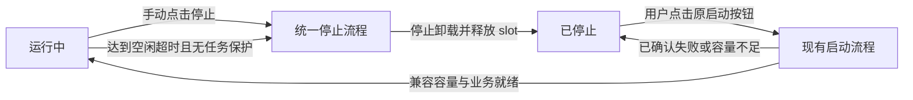

# CM Lite 实例自动停止功能设计评审稿

日期：2026-11-02

版本：第五版修订，关闭默认自主后台功能，检查周期与空闲超时均按天配置

状态：方案阶段记录。当前实现与验收见[发布准备记录](../tests/2026-11-04-lite-elastic-release-preparation.md)。
代码基线：ClawManager `66c5c4d`、AgentsRuntime `8a0dddb` 及当前工作区

## 1 功能边界与本版决策

本功能仅适用于 Lite，默认开启，不增加观察模式。管理员可关闭功能，分别配置以整数天为单位的检查周期和空闲超时，并对指定实例设置“保持运行”。两项均默认1天、最小1天；每隔配置的检查天数在北京时间04:00分批判断一次。默认空闲门槛为连续24小时，实际停止不会早于配置的空闲时长，正常情况下可延迟约一个检查周期。

本版统一口径为“是否有经过CM AI Gateway的有效模型活动”，不再尝试自动判断调用是否有意义或是否由真人发起。默认关闭OpenClaw的周期心跳、梦境/后台记忆巩固、技能工坊自主学习与每周整理，以减少无人使用时的默认模型活动。剩余有效请求全部保守计活动，包括人工交互、原生计划任务、标题生成、压缩、后台事件、用户重新开启的自主功能及失败请求。

手动停止与空闲自动停止统一属于 `stopped`，资源释放、数据保留和恢复语义相同，只通过 `stopped_reason=manual/idle_timeout` 和审计区分。界面可以显示“空闲自动停止”，不新增sleeping/suspended资源状态。恢复只复用现有“启动”按钮及Start接口，必须由有权限的用户或管理员显式操作。

访问、分享链接、模型请求、Team派发、轮询、健康心跳都不自动启动停止实例。停止释放实例业务进程、slot分配、writer和挂载；保留实例身份和持久化数据。共享容器的supervisor、Pod及Kubernetes requests可能保留。

| 评审决策 | 本版处理 |
| --- | --- |
| Lite限定、默认开启 | Pro不参与，不要求先配置实例白名单 |
| 不需要观察模式 | 保留开关；完整采集窗口与能力验收属于安全前提 |
| 空闲超时按天配置 | 默认1天、最小1天，整数天，按滚动的天数×24小时计算 |
| 检查周期按天配置 | 默认1天、最小1天，整数天，与空闲超时独立 |
| 平台统一判断 | 统一Gateway入场/结束活动汇总，不读取每类Agent对话判断空闲 |
| 默认关闭自主后台调用 | OpenClaw三个独立开关见第3节；正常会话压缩、标题生成保留 |
| 不再需要语义分类 | 本版不接入Jev，不增加call_purpose或用途Header，不按prompt排除调用 |
| 内部计划任务可能不可见 | 不推断不存在任务；低频或无模型工作通过“保持运行”豁免 |
| 手动与自动停止同类 | 同一停止链路、同一stopped状态、同一Start按钮 |

“无Gateway模型活动”不等于“无人使用”。本功能不承诺自动发现全部原生计划任务，也不承诺仅凭模型请求覆盖终端和文件操作；CM禁止Agent直连外部模型，模型调用统一经过AI Gateway；第4、16节明确处理边界。

## 2 容器释放的具体含义

CM Lite 的调度单位是共享 Runtime Pod 中的 slot 容器。一个实例停止后，其 slot 可被其他兼容实例分配，不保留「原容器专属权」；再次启动时可以使用另一空闲 slot。

```text
停止前：slot 0 → 实例 A，slot 1 → 实例 B
A 停止：slot 0 → 空闲，slot 1 → 实例 B
重新使用：slot 0 → 实例 C，slot 1 → 实例 B
A 手动启动：申请任一兼容空闲 slot，挂载 A 的持久化工作区
```

释放前必须证明 A 的业务进程及子工作已停止、工作区已卸载、writer 已释放。只改数据库中的 used_slots 或把界面改成停止不算完成。

slot 容器的公共 supervisor 可以继续存活并报告空闲状态。该容器不再占用 A 的业务资源，但容器基础开销和 Kubernetes requests 仍可能存在。不能删除共享 Pod 来释放其中一个 slot，否则会影响其他实例。

本功能不新增 Runtime 池自动缩容、自动迁移活跃实例或全池归零。空 Pod 如需删除，继续使用现有 Runtime 管理的安全缩容功能。池容量不足时可复用现有扩容机制，见第 7 节。

## 3 管理员设置与后台功能默认值

### 3.1 自动停止设置

入口：管理员控制台 → Runtime管理 → 自动停止设置，复用现有页面，不新增独立调度控制台。

| 配置 | 默认值及行为 |
| --- | --- |
| 自动停止 | 开启，仅Lite |
| 空闲超时 | 整数天，默认1天、最小1天；按滚动的天数×24小时判断 |
| 检查周期 | 整数天，默认1天、最小1天；配置N天即每N天检查一次 |
| 实例保持运行 | 默认关闭，由管理员按实例豁免 |
| 同时停止数 | 初值4，复用现有安全并发约束 |
| 人工启动等待资源期限 | 建议120秒，有界等待，不无限后台重试 |

“保持运行”与关闭全局自动停止只影响后续回收，不自动启动已停止实例。管理员不能以打开全局开关绕过存储、监测或安全停止能力检查。

检查周期字段为 `check_interval_days`，空闲超时为 `idle_timeout_days`，前后端均校验为大于等于1的整数；0、负数、小数或非数值输入均拒绝。两者独立：例如检查周期2天、空闲超时1天，表示每2天检查一次，仅停止连续至少24小时没有模型活动且满足保护条件的实例。

首次启用或修改检查周期后，从下一个北京时间04:00开始检查，此后每N天执行一次。平台持久保存下一次计划检查时间并在管理页展示；Backend重启保留该时间，错过计划时幂等补跑一轮，不按漏掉的次数并发堆积扫描。修改检查周期不重置实例活动时间或连续监测起点。修改空闲超时后按新阈值在后续检查中重算；尚未提交的候选需核对最新配置版本，不在保存设置时直接停止实例。

实例列表/详情显示：最后Gateway模型活动时间、连续监测起点、保持运行、停止原因及当前回收阻断原因。文案使用“模型活动”，不把该字段命名为“最后人工访问”或“最后业务活动”。停止时间复用 `stopped_at`，恢复仍用原启动按钮。

### 3.2 OpenClaw Lite的三个独立默认值

针对当前锁定的OpenClaw 2026.10.2，在CM托管默认配置中使用：

```json
{
  "agents": {
    "defaults": {
      "heartbeat": { "every": "0m" }
    }
  },
  "plugins": {
    "entries": {
      "memory-core": {
        "config": {
          "dreaming": { "enabled": false }
        }
      }
    }
  },
  "skills": {
    "workshop": {
      "autonomous": { "mode": "off" }
    }
  }
}
```

| 设置 | 默认关闭的行为 | 保留的能力及影响 |
| --- | --- | --- |
| `agents.defaults.heartbeat.every="0m"` | 周期自主巡检心跳 | CM健康上报继续；定向事件续执行仍可能调用模型 |
| `plugins.entries.memory-core.config.dreaming.enabled=false` | 默认梦境、日记和后台记忆巩固调度 | 普通记忆读写不以此开关整体关闭；失去自动记忆巩固能力 |
| `skills.workshop.autonomous.mode="off"` | 会话后的自主学习与每周技能工坊整理 | 不整体禁用技能插件，不删除已有技能或原生业务计划任务 |

三个开关相互独立，关闭心跳不等于关闭梦境和技能整理。`heartbeat.target="none"`、隐藏心跳应答和当前的 `no-route` 跳过都不是本方案的禁用设置。也不通过关闭整个cron调度器来关闭这些功能，以免影响用户业务计划任务。

每Agent的心跳覆盖项必须一起检查：全局default为0m，不能证明单个Agent没有独立开启。用户明确重新开启的自主功能按普通配置保留，其产生的Gateway请求全部刷新活跃度，可能导致实例不再空闲；不重新引入用途识别来忽略它们。

Hermes、OpenCode、DSH当前部署未发现默认运行的日级梦境任务，不人为添加这三个OpenClaw专用字段。正常会话标题生成、上下文压缩和业务任务后续工作保留，调用Gateway即计活动。

### 3.3 新旧实例与版本适配

1. 新建Lite实例首次生成原生配置时写入上述默认值，不仅修改镜像内模板。后续配置重建、重启或迁移不得把已保存的false/off重新补成上游的true/auto。
2. 已存在OpenClaw Lite按实例处理配置迁移：将可确认来自旧CM默认值的设置改为新默认；保存原值、配置版本和变更审计。仅修改新实例模板不能覆盖已有实例。
3. 已确认由用户显式设置的自主功能作为覆盖保留并展示。无法区分旧默认与人工设置的配置先保留，标为来源不明待管理员处理，不凭当前值为true就擅自判断是旧默认；可继续按全部Gateway请求保守统计，不承诺后台调用已经关闭。
4. 优先使用当前版本支持的配置重载和原生任务协调；核对持久配置、有效配置、每Agent覆盖及已生成的系统任务。原有心跳、梦境和技能整理任务不应因重启被重新创建为启用。只处理这些受管系统任务，不按名字批量删除用户任务。
5. 若某版本需要重启才能生效，复用维护或下次人工启动，界面明确“待重启生效”；不在本功能中批量强杀正在运行的实例。配置完成迁移或显式覆盖已记录后再从可信起点积累空闲窗口。
6. 默认策略记录版本，优先复用既有实例配置快照/元数据。固定交付镜像逐一验证；升级后字段被弃用或迁移到普通自动化任务时，必须适配并重新验证，不静默沿用旧字段。
7. 自动停止功能关闭时，不自动恢复这三个后台功能；它们是独立的Lite默认策略，恢复需要明确配置变更。

当前实现中的 `mergeOpenClawLiteDefaults` 仍默认开启梦境；“本方案决定默认关闭”不表示代码或测试集群已修改。字段依据：[当前版本心跳](https://github.com/openclaw/openclaw/blob/b8952d477f0c932d8ddc6da5c89cab5a169b6ff1/docs/gateway/heartbeat.md)、[梦境](https://github.com/openclaw/openclaw/blob/b8952d477f0c932d8ddc6da5c89cab5a169b6ff1/docs/concepts/dreaming.md)、[技能工坊配置](https://github.com/openclaw/openclaw/blob/b8952d477f0c932d8ddc6da5c89cab5a169b6ff1/docs/tools/skill-workshop/configuration.md)。

## 4 Gateway模型活跃度的统一采集与日级判断

### 4.1 统计口径

唯一主时钟命名为 `last_gateway_activity_at`，不再使用 `last_business_activity_at`。所有通过鉴权、请求有效、能可信归属当前Lite实例的受管模型请求均计入，包括交互、cron、工具续跑、压缩、标题、图片等已启用推理入口，以及用户重新开启的后台功能。

合法请求即使发生上游错误、超时、余额/额度不足或后续取消，也表明实例发起了模型使用，保守计活动；不要求外部模型成功输出或产生计费token。鉴权失败、格式错误、无法归属实例的外部请求、健康探针和状态轮询不刷新该实例时钟。

不使用call_purpose、trigger、提示词、会话名、token数或模型判别结果排除调用。一个调用方自报“这是维护”也不能获得统计豁免。无法确认实例归属的模型请求不能默默漏计后宣称覆盖完整，应作为接入异常处理。

### 4.2 请求入场与结束

```text
任一受管模型入口
  → 鉴权、校验请求、绑定当前实例与运行代次
  → 持久登记请求保护scope，更新last_gateway_activity_at和activity_version
  → 转发/执行模型请求
  → 完成、失败或取消后再次更新时间，并结算该请求scope
```

使用CM服务端UTC时间，更新取最大值，晚到回执和并发请求不得使时钟倒退。入场必须在转发前完成，不能只等流式输出结束才有活动证据。需覆盖实际交付的Chat Completions、Responses、Messages及启用的异步推理入口；Gateway公共路径接入一次，各Runtime不实现不同的空闲算法。

当前 `model_invocations` 可复用实例归属、状态和时间用于审计，但结算落库失败只记日志，不能作为唯一空闲依据。本版新增轻量、持久、按实例唯一的活动汇总和共享执行保护，不扫描完整对话或模型内容。

关键活动登记失败时拒绝本次请求且不转发上游，返回可重试的服务错误；不允许“只记日志继续执行”制造不可见调用。详细审计正文写入失败，如果关键活动与保护已持久成功，不单独使实例变为空闲。结束登记失败保留未结清保护并阻断停止，直到重试或核实，不能按超时直接清零。

### 4.3 连续监测与初始化

`monitoring_since` 表示本轮可信、连续覆盖的起点，不是Pod心跳时间。新建、手动重新启动、首次接入本功能、关键采集缺口恢复后，至少重新积累配置的完整空闲窗口（默认24小时）。可保留历史模型时间供展示，但缺少历史记录不能证明已经达到配置的空闲时长。

后台重启不必无条件重置起点：只有持久活动、未结清scope和停机隔离均可恢复、且没有不可观测执行间隙时才允许延续。无法证明则重置 `monitoring_since`，宁可延迟回收。

所有影响该时钟的模型调用必须走CM网关，这是CM既有平台约束。空闲调度复用现有托管出口、模型域名出网拦截和Gateway活动登记，不增加逐实例的模型覆盖资格或直连豁免。若发现真正绕过，应修复平台安全约束的实现缺陷；观测故障仍按关键登记失败和监测缺口处理。

### 4.4 按检查周期选择候选

```text
idle_anchor = max(
    last_gateway_activity_at（存在时）,
    当前代次启动就绪时间,
    monitoring_since
)

eligible =
    运行中的Lite实例，自动停止已开启，未设置保持运行
    且 now_utc - idle_anchor >= idle_timeout_days × 24小时
    且 idle_timeout_days为整数且 >= 1
    且Gateway关键活动登记及连续监测正常
    且当前没有进行中或状态未知的受保护工作
    且没有升级、迁移、备份、人工启停等冲突操作
    且持久化与确认优雅停止能力合格
```

到达配置的检查周期时扫描轻量汇总即可，不调用判别模型。扫描仅选候选，不授权停止；执行前在实例生命周期锁下重读最新时钟、activity_version和保护。扫描后新来的模型请求照常计入，提交停止前必须看到它，因此不需要语义判别的“当天尾部补判”。

扫描多副本重复或中断后补跑依靠同一实例锁、唯一操作和条件更新幂等执行。没有新增记录的实例不需要额外模型请求，判断任务自身也不调用模型，不会自我刷新空闲时间。

### 4.5 当前执行与非模型使用

活动时钟与当前执行保护是两个条件。模型HTTP请求结束不代表后续工具、子任务、终端命令或异步图片任务结束；这些工作须由其真实生命周期保护。保护必须共享/可恢复，不能只查某个Backend进程内map，也不能把租约过期等同于任务结束。

平台能观测的正在执行任务、文件写入和终端命令阻止本次自动停止。普通页面查看、静态资源、轮询或打开空连接不刷新按天累计的模型活动时钟，也不永久占用保护。长期只操作终端/文件、执行本地程序或原生后台任务的实例使用保持运行；本版不新增“所有访问都算活跃”的第二套时钟。

2026-11-03 用户明确：OpenClaw、Hermes、OpenCode、DSH 四类 Lite 统一按 Gateway 模型活动判断，不要求镜像提供原生任务静默证明，不因缺少类型适配而跳过。CM 保留已有在途模型请求、平台命令/写入和冲突操作保护；Runtime 只关闭公共受管命令入场并执行公共 supervisor 的优雅停止。Agent 内部不可观测的本地任务和未来计划不另设资格门槛，确需持续运行时使用管理员保持运行。

### 4.6 周期任务政策

不新增 `has_enabled_schedule`、原生任务注册表或周期任务文件扫描来决定空闲。原生任务调用Gateway即刷新时钟。月度/年度、尚未首次执行或完全不用模型的任务，可能在配置的空闲窗口内没有记录；要求持续运行时，管理员明确设置保持运行。

本版不承诺自动发现并保护所有原生周期任务。若产品要求任何内部计划任务一律不能休眠，就必须额外引入完整登记/保活协议；仅凭Gateway记录无法满足这一要求。当前选择显式豁免，以保持统一平台方案。

## 5 手动与自动停止共用状态和资源释放

### 5.1 当前 Stop 已经释放什么

当前 Lite 路径为 Stop → stopV2Instance → cleanupV2GatewayBinding → DeleteGateway → DeleteByInstanceIDAndReleaseSlot。对于当前启用确认 teardown 的 slot 客户端，只有 stopped/confirmed/unmounted 回执匹配后才会确认停止、删除 binding 并释放 slot。

因此，正常完成的手动 Stop 已经达到本功能期望的资源效果：业务进程退出，运行分配和 writer 释放，slot 可被其他实例使用，工作区保留。自动停止复用同一条公共执行链路，不能另造一套「睡眠容器」生命周期。

共享 Pod、空 slot 的管理进程和 Kubernetes requests 仍可能保留；这与自动停止相同。释放实例进程/slot，不等于删除整个 Pod 或工作节点。

### 5.2 统一显示与操作

| 底层事实 | 界面状态 | 后续操作 |
| --- | --- | --- |
| running | 运行中 | 现有停止按钮 |
| stopped + 有未完成 stop 操作，不论触发原因 | 正在停止或资源释放异常 | 禁止并发启动，继续确认清理 |
| stopped + 已确认清理，reason=manual | 已停止，手动停止 | 原「启动」按钮 |
| stopped + 已确认清理，reason=idle_timeout | 已停止，空闲自动停止 | 原「启动」按钮 |
| stopped + 历史原因/清理证据不完整 | 已停止，需核实资源释放 | 按既有确认清理路径检查，不据列表状态推断 slot 已空闲 |
| creating，关联人工启动操作 | 正在启动/等待运行资源 | 复用现有启动进度，禁止重复提交 |
| error | 异常 | 沿用当前错误与人工处理方式 |

只扩展 stopped_reason 并复用 stopped_at；停止中和资源释放结果保存在统一 stop 操作记录里，不增加额外睡眠原因或状态。手动和自动停止都采用这个展示和安全准入，自动路径不能隐式执行手动强制停止。



### 5.3 stopped 状态不是独立的释放证明

当前 stopV2Instance 先更新 stopped 并广播，再调用 cleanupV2GatewayBinding。若随后 Runtime 不可达、停止未确认或清理失败，实例可能已显示 stopped，但 binding/slot 仍被保留。不能据 status=stopped 直接把这些资源再分配。

本功能需要补齐共用 stop 操作的清理阶段/失败原因展示及幂等核实，使手动和自动两条入口都可知道「资源释放已确认」。历史 stopped 实例只做确认清理，不自动启动，也不能因状态为 stopped 就直接删除未确认的 binding。

自动停止额外检查连续idle_timeout_days×24小时无Gateway模型活动、当前执行保护和保持运行设置；手动 Stop 属于明确的用户操作，复用相同资源释放语义。停止后内部定时任务不会继续运行；按最新政策，计划任务存在性不再单独阻止自动停止。

停止实例从调度器期望运行、自动故障恢复和心跳恢复范围排除。Team 显示「已停止，需手动启动」，不把派发任务当成启动依据。代理、分享页、模型请求和后台轮询只返回停止原因，不执行 Start。

现有 Agent 控制面 desired_power_state 也必须协同：统一停止写入业务进程不应运行的目标，人工 Start 在新代次恢复运行目标；保留配置版本字段。历史上用户主动停止原生业务进程的实例仍按原语义处理，不能被访问、心跳或本地 supervisor 自行启动。

## 6 自动停止和资源释放流程

1. 每隔check_interval_days天在北京时间04:00分批扫描正在运行的 Lite，按last_gateway_activity_at、当前启动就绪时间与连续采集起点选出达到idle_timeout_days天阈值的候选。
2. 取得现有跨 Backend 实例生命周期锁，短事务重读最新Gateway模型活动时间、当前执行保护、保持运行设置和冲突操作。
3. 登记持久化 stop 操作，固定 instance/owner/generation/gateway/Pod UID/slot/工作区身份；写停止目标和统一 stop 操作的 stopping 阶段并建立分配隔离；复用当前 stopped 目标语义，不冒充已经物理停机。
4. 平台新业务入场被拒绝；与停止竞争的已登记请求已经在第 2 步阻止本次回收。后台调度和 Runtime 自恢复不得重新创建该分配。
5. 通过公共 slot 生命周期执行优雅停止，等待业务进程、子工作和挂载释放，核对源身份匹配的确认回执。
6. 确认后释放 binding、slot 和 writer 占用，清除活动路由和旧实例会话，完成统一 stop 操作，写 stopped_reason=idle_timeout 并更新既有 stopped_at，广播「已停止」。
7. 该 slot 即可分配给其他兼容实例；A 的工作区保留，与下一租用者隔离。

现有 slot DeleteGateway 已要求 stopped/confirmed/unmounted 回执，可以复用这条确认与释放链路。但当前公共进程停止实现含超时强杀分支，不能把「最终停止确认」等同于「应用已经正常刷盘」。自动停止需要在同一公共 supervisor 中增加或选用 graceful_only 停止方式，超时/信号失败不自动升级为强杀；不要求每类 Agent 各写一套停止算法。

优雅停止或卸载结果未知时保留 slot 和 writer 占用，操作显示需处理，不设置最终 idle_timeout，也不让新实例复用。已经发送终止信号后不能假装恢复成正常运行；先核实源运行单元，再由管理员显式启动或完成清理。

普通手动停止的既有强制处理能力若保留，应是用户明确选择的现有操作，不由自动停止隐式调用。仅有旧版强杀停止路径的镜像显示安全能力不满足，自动停止开关仍为开启，但该实例暂不执行回收。

## 7 手动启动时资源不足

停止释放的是计算分配，不承诺下次能拿回原 slot。用户点击启动后按以下顺序处理：

1. 复用现有 Start 权限、生命周期互斥、配置检查和原工作区身份，检查是否有兼容空闲 slot。
2. 有容量则原子预留，递增 runtime_generation，沿用现有启动与业务就绪检查。
3. 没有空闲 slot 但现有服务池允许安全扩容时，复用当前积压扩容机制，在本次人工启动操作的期限内准备容量，界面显示「等待运行资源」。这是用户点击后启动流程的继续，不是请求触发自动启动。
4. 池被维护隔离、镜像/存储不兼容、配额/资源预算不足、扩容被禁止或达到期限时，明确返回具体原因。
5. 已确认尚未启动、没有不确定 writer 时，取消本次预留和后续重试，恢复为 stopped，保留本次启动前的 stopped_reason/stopped_at，并保存 last_start_error；不能把原本手动停止的实例改成空闲自动停止。资源以后释放时不会自行再次启动，用户需重新点击。

建议容量与启动总期限 120 秒。明确不可满足的准入条件立即失败，不让用户无意义等待。不得抢占其他正在运行的实例，不保留原 slot 专属权，不建立一个资源可用后无限期自动启动的队列，也不为此新增无上限扩容策略。若服务池尚无明确安全资源预算，则该次启动不自动扩容，由管理员先在现有 Runtime 管理中增加容量。

启动请求超时或响应丢失不等于没有进程。发现已提交但结果未知的 assignment 时保持现有隔离并核实，不能一边把界面改回停止，一边留下迟到启动。人工 Stop/取消使该启动操作失效后，延迟回执和旧工作者不得继续创建。

同一实例重复点击启动通过现有锁和关联操作合并为一次执行；不同实例抢最后一个 slot 必须原子分配，失败者进入上述有期限的容量处理。现有 GetV2DesiredRunning 对 error 的自动重试也需校验这次人工启动是否仍有效，不能在期限结束后偷偷恢复。

## 8 如何保证持久化存储

### 8.1 数据属于实例，不属于 slot

实例 ID、owner、工作区存储身份和路径在停止时保留。默认工作区结构沿用：

```text
/workspaces/{runtime}/user-{user_id}/instance-{instance_id}/
    home/         实例 HOME，包含原生配置及持久化状态
    ...           工作文件及其他已管理的数据

/workspaces/.clawmanager-instance-tmp/{runtime}/user-{user_id}/instance-{instance_id}/tmp/
                  当前公共 slot 实现提供的实例持久化 tmp
```

slot 只挂载当前分配实例的这些目录。A 停止后不删除、重建、清空或转给 C；C 取得同一 slot 时挂载 C 的目录，不能读取 A 的数据。A 再启动时挂载 A 原来的数据，可能是另一个 slot，不依赖原容器可写层。

现有 gateway 公共逻辑已经将 HOME 设置到 workspace/home，并按用户/实例校验工作区；公共 slot 层也有实例 tmp 映射。需要验收实际镜像是否把会话数据库、配置、插件、凭据和业务文件写在这些持久路径中。镜像打包路径验收可以按 Runtime 分别做，但空闲判断算法仍统一。

### 8.2 停止资格必须检查真实卷

1. workspace 根目录实际位于合格的持久化存储，不能仅检查目录存在。
2. 使用 PVC 时校验 namespace、claim 和 PVC UID 等既有存储身份；使用 NFS 时校验受管理导出和相同持久化根。
3. 当前代码存在没有配置 PVC/NFS 时回退 emptyDir 的路径，这种实例不能直接获得自动停止的数据安全承诺，应跳过并显示 STORAGE_NOT_DURABLE，先完成持久化迁移。
4. 节点本地卷只能在数据可达的节点恢复，保存并遵守存储放置约束；跨节点需要已验证的共享存储和兼容挂载。
5. 启动前检查原卷和原工作区仍存在、身份与权限匹配。丢失/不可达时失败，不因现有 ensureWorkspace 的建目录行为生成空目录来冒充恢复成功。
6. 活跃共享 Team 目录保留原权限和挂载关系，不将其归属于可随 slot 清理的临时数据。

### 8.3 停止和恢复的一致性

先拒绝新写入，再让应用优雅退出并完成其正常刷盘，确认所有 writer、子进程和挂载已释放，最后复用 slot。当前 stopped/confirmed/unmounted 回执证明清理完成，但本身不证明应用未被强杀或未丢失内存缓存，因此自动停止必须使用第 6 节的公共优雅停止约束。

本功能保证合格持久存储中已经持久写入的数据按实例保留，不能承诺任意应用未保存的编辑内容、内存变量和执行现场可恢复。底层卷的硬件故障保护、备份和灾备沿用现有存储方案，不把「没有删除 PVC」等同于零数据损失。

不需要每次停止复制一份完整工作区，也不需要停止时自动备份；避免为释放 slot 引入不必要的数据搬运。恢复时不自动升级镜像，不在同一次启动中隐式执行数据格式迁移。

## 9 停止期间的心跳与故障恢复

### 9.1 区分管理心跳和实例心跳

| 信号 | 停止后的预期 | 平台行为 |
| --- | --- | --- |
| Runtime Pod/coordinator 管理心跳 | 继续 | 表示共享池健康，不代表每个历史实例在线 |
| 空 slot supervisor 上报 | 可继续 | 上报可分配/空闲，不绑定已停止实例 |
| 实例业务 Agent 心跳 | 停止 | 这是计划停机，不告警为故障，不据此重建 |
| 停止前在网络中延迟的上报 | 可能晚到 | 不能覆盖停止原因、online 状态或创建新分配 |

不要通过持续发送假业务心跳维持停止实例在线，也不要把 Pod 的 LastSeenAt 当成已停止实例的 last_used_at。界面展示「停止，业务心跳已停止」，历史最后在线时间保留作历史信息。

### 9.2 先记录目标，再执行停止

停止前先登记操作隔离并写停止目标和 stop 操作的 stopping 阶段，Scheduler、实例健康巡检、Team 状态同步、Agent 本地重启和 assignment 重放都必须承认该目标。否则主动停止后的一次 missing/failed 报告可能把实例改回 creating，造成释放后又自动拉起。

停止完成后删除活动 binding、使旧会话失效；业务心跳和状态报告只允许更新当前有效运行分配。stopped、停止处理中或已停止实例不接受「running」上报将其重新上线。

### 9.3 旧上报与新运行代次隔离

手动 Start 沿用 runtime_generation + 1。Runtime Gateway 上报已携带 generation，继续核对实例、分配和 Pod UID；旧代次必须被拒绝。

现有通用 Instance Agent 心跳请求并未显式携带完整运行代次，不能宣称仅用当前接口已经完成隔离。Lite 的注册/会话需绑定当前 generation 和 assignment，停机撤销旧 session，新启动使用新代次的注册凭据或证明，防止旧进程用复用的 bootstrap 凭据重新注册。此改造放在公共 Agent 协议层，不为每类原生 Agent 实现不同的心跳方案。

状态更新最终落库时也要检查实例目标和代次，不能只在 handler 入口查一次后无条件更新，避免与停止事务竞争。没有当前 binding 的历史 gateway 报告只记诊断，不产生实例恢复需求。

### 9.4 Backend 或 Runtime 重启

Backend 恢复时加载未完成停止和人工启动操作：未完成的 stop 操作继续核实停止/卸载，已完成 idle_timeout 保持停止。旧 assignment 的后台重放必须校验当前停止隔离，不能重新发布停止实例的运行请求。

Runtime 重启后，旧 slot writer 状态如果未知，继续使用现有 quarantine/确认流程。不能因 slot supervisor 重启或心跳恢复，就把其上一次承载的实例重新启动。

## 10 并发和异常处理

| 场景 | 处理 |
| --- | --- |
| 扫描后来了有效模型请求或受保护操作 | 请求/操作登记与候选提交竞争同一实例版本，请求或受保护操作先入场则取消候选 |
| 停止隔离后来了业务请求 | 返回正在停止/已停止，不自动启动，不缓存等待以后投递 |
| 停止中用户点启动 | 操作进行中返回明确冲突，完成后用户再次点击；不隐式安排自动恢复 |
| 多人同时点启动 | 原生命周期锁和唯一关联启动操作保证一次分配 |
| 多实例争用同一 slot | 原子预留，失败者进入有期限的容量处理 |
| 停止或卸载失败 | 不释放 binding/slot/writer；标记处理异常，人工核实 |
| 容量准备或启动超时 | 确认没有残留运行单元后恢复停止，终止后续自动重试 |
| 用户手动停止/删除与停止竞争 | 复用同一锁，保留明确人工意图；不让迟到停止结果覆盖已删除/新代次 |
| 原生任务发起模型调用与自动停止竞争 | 有效模型请求入场和停止提交原子竞争，调用先入场则重置计时；停止先隔离则拒绝，不自动启动 |
| 升级/备份/迁移/维护 | 复用既有隔离，冲突时跳过本次停止 |
| 活动登记或数据库故障 | 停止新回收；关键入场登记失败不转发模型请求；监测缺口恢复后重新累计窗口 |
| 停止期间关闭功能或设置保持运行 | 不再发起新停止；已停止实例保持停止，由用户点击启动 |

实例操作记录先于外部副作用提交，绑定固定源身份并可幂等恢复。停止结果不明确时不能因数据库锁过期、操作超时或 Backend 重启释放资源。

短事务用于阶段和活动条件更新；停止和启动不占用长数据库事务。Leader 只减少重复扫描，数据库条件更新和既有生命周期锁保障多 Backend 正确性。

## 11 最小数据与接口改造

### 11.1 数据

| 数据 | 新增或复用 |
| --- | --- |
| 全局配置 | enabled默认true；check_interval_days与idle_timeout_days均为整数、默认1且不小于1；持久保存下一次计划检查时间 |
| 实例设置 | 保持运行标志；默认策略版本及实际生效/显式覆盖/待迁移状态，优先复用配置快照 |
| 模型活动汇总 | last_gateway_activity_at、monitoring_since、activity_version；按实例唯一，服务端时间原子取最大值 |
| 执行保护 | 请求及实际任务scope，绑定当前generation/assignment，包含未结清和状态未知，不使用TTL直接证明结束 |
| 停止原因 | stopped_reason=manual/idle_timeout，历史使用legacy_unknown，复用stopped_at |
| 生命周期操作 | 共用stop操作记录源身份、阶段、清理回执；人工Start关联操作、期限与last_start_error |

不新增调用用途字段或分类协议、判别模型客户端、对话分块/去重任务、唤醒队列、原生任务清单或独立容量控制器。活动汇总属于请求控制元数据，不需要保存对话正文。

### 11.2 接口和前端

- 复用现有Start和Stop，增加停止原因、资源释放确认和人工启动期限；不增加Wake API。
- 管理员配置GET/PUT保存开关、检查周期与空闲超时；实例设置接口保存保持运行。配置变更携带版本避免相互覆盖。
- 实例详情/列表展示最后Gateway模型活动、监测起点、默认后台策略生效状态和自动停止阻断原因。
- 停止时访问代理返回409或协议等价的INSTANCE_STOPPED原因，不返回会自动启动的202，不缓存等待启动。
- Team展示RUNTIME_STOPPED，先人工Start，再显式重试/派发。分享链接不授予Start权限。
- 审计记录默认策略应用、覆盖、迁移、人工启停、自动停止与失败原因，不包含令牌或对话正文。

## 12 默认开启与发布、迁移和回退

1. 部署轻量活动汇总、关键入场登记、执行保护和停止隔离；新增字段做增量迁移，既有stopped保留legacy_unknown，不据此认定资源已释放。
2. 上线能识别新原因的Backend/前端和公共Runtime安全停止能力，旧Backend退出前不执行自动停止。
3. 应用OpenClaw Lite三项默认关闭策略，并核实新实例、已有默认实例、明确人工覆盖和来源不明实例的处理。热重载需有实际生效证据；待重启者明确标识。
4. 每个合格实例从可信连续监测起点收集至少idle_timeout_days×24小时（默认24小时），期间所有有效模型活动都刷新时钟。不能用部署前“没有已分类历史”的假设追溯回收。
5. 达到空闲阈值后按配置的检查周期扫描并自动停止，不要求管理员先切观察模式。不具备存储、完整监测、执行保护或优雅停止能力的实例显示具体阻断原因。

关闭功能不唤醒已停止实例，也不重新开启梦境等自主功能。回退前停止发起新回收，等待未完成Stop/Start操作收敛，保留旧心跳/assignment隔离。数据库字段保留，不做破坏性向下迁移。

默认策略回退与自动停止回退分别处理：回退旧镜像可能重新启用上游默认任务，应保留已保存的false/off，并在恢复旧配置前明确核对。不得为了回退统一开启用户原本关闭的功能，或清空其记忆、技能和工作区。

## 13 验收标准

下列为后续实现验收，本轮只完成设计更新，不表示已经通过产品验收。

| 编号 | 场景 | 通过标准 |
| --- | --- | --- |
| A01 | 范围和默认 | 仅Lite默认开启；Pro不受本方案更改；无第三种观察模式 |
| A02 | 空闲边界 | 默认1天、最小1天；23小时59分不得回收，连续24小时仅达到默认空闲门槛，更大阈值按天数×24小时计算 |
| A03 | 历史和初始化 | 无可靠历史、新启动或监测缺口恢复后完整累计窗口，不凭空记录立即停止 |
| A04 | 请求归属 | 用户、原生渠道、cron及所有已启用推理协议正确归属当前实例和代次 |
| A05 | 活动更新 | 有效请求转发前持久登记，结束再更新，失败/额度不足等也保守计活动，时间不倒退 |
| A06 | 不做用途排除 | 心跳标签、低token、历史上下文、标题/压缩及用户重新开启的后台调用都不能绕过活动计时 |
| A07 | 关键登记失败 | 关键登记失败不转发；结算失败保留保护，详细审计失败不破坏已有活动证据 |
| A08 | 噪声和身份 | 健康心跳、页面轮询、静态资源、空WebSocket及鉴权失败不刷新模型时钟 |
| A09 | 统一判定与执行保护 | 四类 Lite 统一由模型活动决定空闲；保留平台已登记请求、命令、写入和冲突保护，不要求原生任务静默证明，不设类型白名单 |
| A10 | 三项默认关闭 | 新OpenClaw Lite的周期心跳0m、dreaming=false、Workshop autonomous=off均实际生效 |
| A11 | 系统任务协调 | 重载/重启后对应既有受管任务不再执行；不误删用户业务cron、不整体关闭调度器 |
| A12 | 覆盖和旧实例 | 每Agent覆盖可见；旧CM默认迁移，人工覆盖保留，来源不明不擅改；待重启生效明确可查 |
| A13 | 版本恢复 | 迁移/重建/升级不恢复旧默认；不支持版本显示待适配，不能仅检查配置文件字符串 |
| A14 | 保持运行 | 低频计划任务、纯终端/文件工作可豁免；设置豁免不启动已停止实例 |
| A15 | 请求与停止竞争 | 请求先入场则更新并阻止回收，停止先隔离则拒绝请求；不得自动唤醒 |
| A16 | slot释放复用 | 源进程、writer和挂载确认释放后他实例可复用，无原实例数据可读残留 |
| A17 | 手动恢复 | 两种停止复用stopped/Start；访问、Team、心跳都不启动实例 |
| A18 | 资源不足 | 原子预留、有界扩容；确认失败后停止后台重试，未知启动先核实 |
| A19 | 持久存储 | 验证实际PVC/NFS，emptyDir阻断；原卷/目录缺失不建空目录冒充恢复 |
| A20 | 换slot数据 | 原数据保留，其他实例复用slot后，原实例在兼容slot可恢复文件/会话并保持隔离 |
| A21 | 优雅停止 | 自动路径不超时强杀；没有可信退出/卸载证明不释放 |
| A22 | stopped与清理 | stopped不是已释放证明；手动/自动均展示正在停止和清理失败 |
| A23 | 旧心跳隔离 | 旧代次、旧凭据、迟到回执不能上线已停止实例或覆盖新代次 |
| A24 | 崩溃恢复 | Backend/Runtime/Leader重启可恢复操作和活动保护，旧assignment不自行启动 |
| A25 | 模型出口约束 | 复用CM禁止Agent直连外部模型的既有约束；发现绕过按平台安全缺陷处理，不新增直连豁免或逐实例覆盖证明门槛 |
| A26 | 维护互斥 | 与人工启停、删除、升级、备份、迁移互斥，不因关闭功能改变已完成状态 |
| A27 | 三类其他Runtime | 正常会话压缩和标题保留且计活动；不写入OpenClaw专用配置，不用其no-route解释其他类型 |
| A28 | 检查周期与效率 | 默认1天、最小1天，按配置的整数天数扫描汇总，无对话分析或判别模型调用，重跑幂等，提交前重核状态和配置 |
| A29 | 两项配置校验 | 两项分别接受1、2、7等整数天，拒绝0、负数、小数和非数值；修改周期不改实例时钟，修改超时按新阈值重算，重启恢复下一检查时间 |

时间边界用可控时钟验证，发布后仍保留真实完整监测窗口。真实MySQL验证并发入场、汇总更新、跨副本锁和失败保护；隔离Kubernetes及固定镜像验证配置生效、优雅停止、slot复用、数据与代次隔离。配置关闭验证不能以“今天没有调用”代替，停止安全也不能只测HTTP状态。

监控记录候选、阻断、停止、清理失败、释放slot、人工Start容量等待/失败、关键登记错误与默认策略迁移状态。进程用量、slot复用与Pod requests分别统计；不把共享Pod的保留资源说成已经归零。

## 14 当前代码依据与后续改造位置

以下只说明落点，不表示已经实现。

| 位置 | 拟改造/复用 |
| --- | --- |
| [OpenClaw Lite默认配置](../../../../AgentsRuntime/openclaw/lite/config_writer.go) | 三项默认关闭，旧默认迁移、显式覆盖与原生任务协调；当前梦境默认true需后续修改 |
| [OpenClaw版本锁](../../../../AgentsRuntime/openclaw/openclaw102.lock.json) | 按2026.10.2及固定源码验证字段、重载和系统任务效果 |
| [模型公共处理](../../../backend/internal/aigateway/service.go) | 复用可信实例归属；补关键入场、活动汇总和请求保护；不新增用途Header |
| [模型调用审计](../../../backend/internal/models/model_invocation.go) | 保留详细调用核对，不作为唯一监测完整性证据 |
| [实例生命周期](../../../backend/internal/services/instance_lifecycle.go) | 复用跨Backend互斥及操作恢复 |
| [实例启停](../../../backend/internal/services/instance_service.go) | 复用Start、Stop和代次；补源存储验证、停止阶段、容量期限 |
| [Runtime调度](../../../backend/internal/services/runtime_scheduler.go) | 按配置天数选择候选、既有扩容、安全资源预算，不新增唤醒队列 |
| [故障恢复保护](../../../backend/internal/services/runtime_upgrade_guard.go) | 排除已停止目标与已失效的人工Start |
| [slot客户端](../../../backend/internal/services/runtime_slot_agent_client.go) | 复用匹配的stopped/confirmed/unmounted证明与释放 |
| [持久化卷创建](../../../backend/internal/services/k8s/runtime_deployment_service.go) | 已有emptyDir回退必须被资格判断排除 |
| [工作区存储](../../../backend/internal/services/runtime_workspace_storage.go) | 原实例存储身份与挂载兼容性 |
| [公共进程停止](../../../../AgentsRuntime/clawmanager-agent/slots/process.go) | 现有路径可能强杀；新增或选用真正graceful_only策略 |
| [公共slot worker](../../../../AgentsRuntime/clawmanager-agent/slots/worker.go) | 源身份、writer、挂载和清理确认 |
| [公共workspace](../../../../AgentsRuntime/clawmanager-agent/gateway/workspace.go) | 数据归实例、不归slot；原目录缺失不冒充恢复 |
| [持久化tmp](../../../../AgentsRuntime/clawmanager-agent/slots/persistent_tmp.go) | 保留实例专属tmp并验证换slot恢复 |
| [健康上报处理](../../../backend/internal/handlers/runtime_agent_handler.go) | 目标状态、代次、分配校验，停止不自动恢复 |
| [实例Agent会话](../../../backend/internal/services/instance_agent_service.go) | 旧注册/会话撤销和新代次隔离 |
| [实例列表](../../../frontend/src/pages/instances/InstanceListPage.tsx) | 保持运行、模型活动、停止原因和释放进度，复用Start |

## 15 本版决策与移除的复杂度

1. OpenClaw Lite默认关闭周期心跳、梦境、技能工坊自主学习/周整理；正常会话压缩、标题、记忆读写及用户业务cron保留。
2. 所有有效Gateway模型请求保守计活跃，不区分真人、后台和用途，不因失败而忽略。
3. 移除此前Runtime来源透传、call_purpose、维护资格校验及Jev每日语义判断；各类型不维护不同空闲算法。
4. 统一轻量活动时钟与可靠请求入场；检查周期和空闲超时均按整数天配置、默认1天且最小1天，监测缺口不作空闲证据。
5. 不引入原生任务清单。低频/无模型业务由管理员设置保持运行，不承诺自动发现所有内部计划任务。
6. 执行保护、真实持久化、优雅停止、代次隔离、释放确认和人工Start容量处理继续是硬条件。
7. 本版是设计更新，不执行配置变更、停止、重启或部署。

## 16 仍需解决的实现差距与明确边界

| 编号 | 问题 | 处理与验收要求 |
| --- | --- | --- |
| R01 | 默认关闭并不保证所有后台调用消失：人工覆盖、遗留受管任务、插件或升级可能重新引入调用 | 核对有效配置和受管任务，保留显式覆盖；残余请求一律计活动，效果是延后回收，不通过排除调用提升回收率 |
| R02 | 网关调用不等于有人使用 | 字段与文案明确模型活动；非模型长期使用靠保持运行，不以prompt或模型输出猜意图 |
| R03 | 模型完成不代表所有本地工作结束；平台不发现 Agent 内部全部未来任务 | 四类统一模型活动口径，不额外要求原生执行证明；需持续运行的低频/无模型业务由管理员保持运行 |
| R04 | 当前详细审计落库为尽力写入 | 新增关键活动入场，在转发前持久成功；失败不转发，结束不确定保留保护；不能只增加日志 |
| R05 | 协议/镜像和配置版本不同，旧字段可能无效，存在每Agent覆盖 | 固定交付版本、实际出口与生效配置验收；升级和迁移重新检查，不以类型定义或字段存在代替效果 |
| R06 | 现有Stop先写stopped再清理，进程路径可能超时强杀 | 共用可恢复停止操作、真实graceful_only与匹配清理证明；未知不释放slot/writer |
| R07 | 达到空闲超时没有调用不证明没有月度/年度/尚未首次触发任务 | 不自动推断计划任务状态；管理员保持运行。要求全量自动保护时需另立完整登记方案 |
| R08 | 纯终端/文件使用、常驻用户程序不能由Gateway模型请求观测 | 使用保持运行及停止前执行保护；模型直连是CM禁止行为，实际绕过作为平台安全缺陷单独处理 |
| R09 | 自动任务、持续故障重试仍可能一直计活动，释放slot也不等于缩掉Pod | 展示最后模型活动和阻断原因；接受保守保活，资源收益分别度量 |

旧版需要证明“维护来源”的分类信任问题随用途排除机制一并移除；停止安全和观测完整性问题没有因此自动解决。本版不能在这些硬条件未验收时直接上线回收。

优先验证：有效请求登记失败时不能转发；四类 Lite 均可在没有原生静默接口的情况下执行公共优雅停止；界面 stopped 但进程/writer 尚未确认退出时不能复用槽位。未登记的 Agent 内部本地工作不作为新增运行时资格门槛。

## 17 实测依据与历史方案处置

[每日对话判别实测报告](../../design/2026-11-02-idle-judge-validation.md)记录了测试集群样本、Jev协议探索、开发评测及后续Runtime检查。报告第14节说明本轮决定，早先章节保留为历史实验结果，不是本版产品判定流程。

主要依据：测试集群58个Lite，原今日快照只有一次默认梦境调用；抽查3个OpenClaw的30分钟周期心跳当天各38次，均在模型执行前因no-route被跳过；技能工坊任务为每周一次。其余46个实例完成配置/进程检查，未发现默认日级梦境任务，但不能据此保证所有插件和原生计划任务不存在。

Jev V1出现业务误判维护；V2小样本改善后，两模型仍将今日和历史默认梦境候选判为业务。低并发效率可行不等于足以安全驱动停止。按本次新决策无需再投入语义分类来排除已决定默认关闭的任务，因此不把Jev接入本版交付依赖。

第三方模型价格和吞吐推算不适用于当前无判别模型的方案；按检查周期执行的空闲扫描没有新增模型token费用。实际平台读取、存储和任务保护的成本仍需在后续实现验收中测量。
