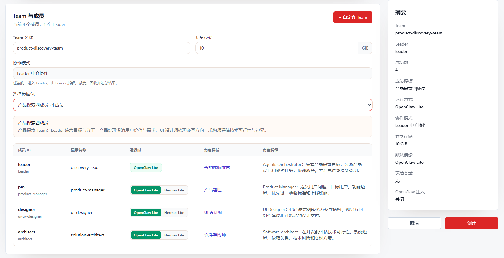
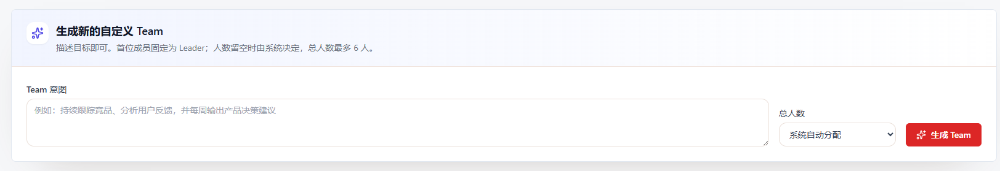
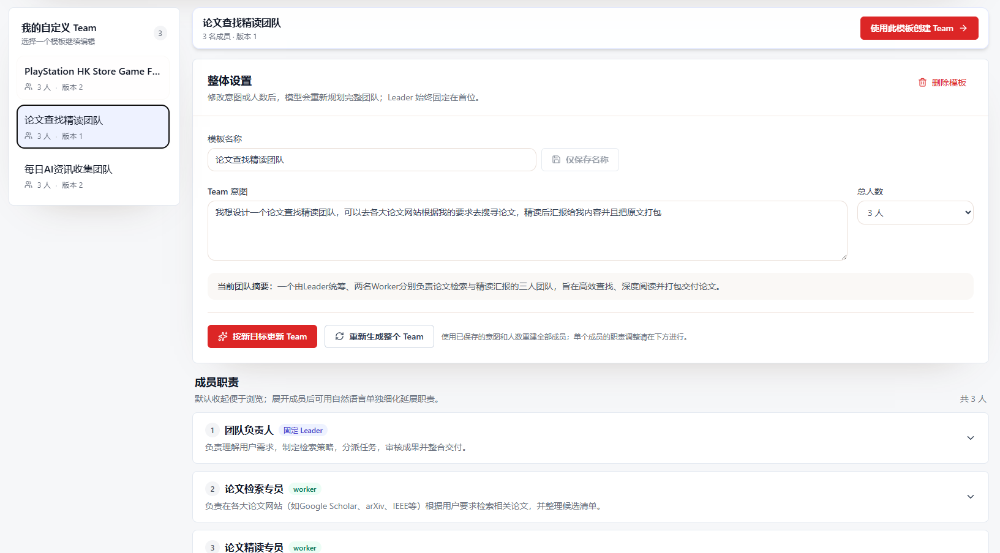
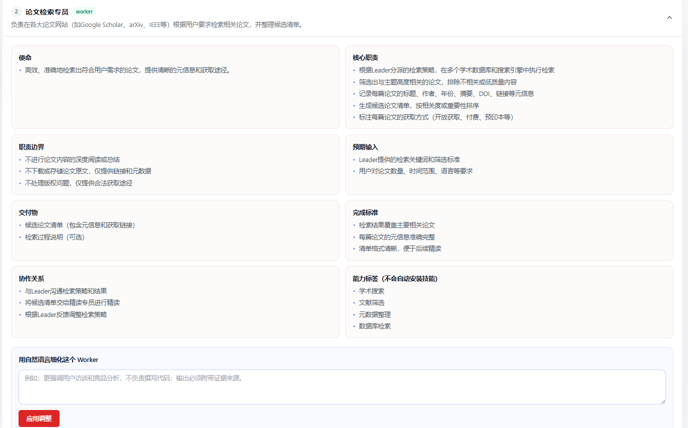

[← Back to README](../README.md)

# Team Workspace Quick Guide

A Team uses one OpenClaw Lite Leader to coordinate multiple Workers around a shared goal. You can start from an immutable built-in template or generate a user-owned custom template from natural-language intent. The Leader understands the request, delegates work, collects member deliveries, handles recovery, and publishes the final result.

The retained screenshots illustrate an earlier interface. The instructions below describe the current continuous-collaboration layout, avatar selection, single-member tasks, and file editing.

## Scope

- The default `@Leader` route uses **Leader-mediated collaboration**. Alternatively, `@` a Worker to execute a new task with that member alone.
- The Leader always uses **OpenClaw Lite**. Each Worker can use **OpenClaw Lite** or **Hermes Lite**.
- Hermes Lite is disabled with an explanation when no enabled Hermes Lite gateway image is configured.
- Built-in templates cannot be changed or deleted. Custom templates belong to the current user and can be refined, deleted, and reused.

## 1. Create a Team from a Built-in Template

1. Open **Teams** from the navigation and enter the creation page.
2. Enter a Team name and adjust shared storage when needed.
3. Choose a template and select an available Runtime for each Worker.
4. Review the summary and select **Create**.

The **+ Custom Team** action in the upper-right opens custom-template management. Worker Runtime selection is available in the member table on the same page.

Eight immutable built-in templates are available: Standard Two-Member, Delivery Three-Member, Product Discovery Four-Member, Quality Gate Four-Member, Full-stack Delivery Five-Member, API Integration Five-Member, Research Publication Six-Member, and Software Engineering Eight-Member. Templates already provide member responsibilities and role profiles, so individual resource-preset setup is not required.

## 2. Generate a Custom Team

Open **Custom Team** and describe what the Team should achieve. Leave the member count empty for automatic allocation, or select a total of 2–6 members.

Generation and responsibility adjustment use the current user's AI Gateway with `model: "auto"`. The gateway chooses the actual model, and that model's saved Thinking setting applies. The Custom Team page has no separate Thinking switch. If no model is available, the page asks the user to enable one in model management.

Every generated result keeps these rules:

- The Team contains 2–6 members.
- The first and only Leader keeps `memberId=leader`.
- Capability tags describe suitable abilities; they do not install Skills or modify Runtime configuration.

## 3. Manage Custom Templates

Select a template under **My Custom Teams** to:

- rename it;
- revise the whole Team after changing the intent or member count;
- regenerate the whole Team from the saved intent and count;
- delete it, or use it on the Team creation page.

Each update creates a new template version. Built-in templates never appear in the editable list.

Functional avatars are matched to member roles, with a generic icon when no unambiguous match exists. Click a Worker avatar during Team creation or custom-template editing to choose another icon. This changes presentation only, not responsibilities, tool permissions, or Runtime settings. Leaders and users retain their own distinct markers.

## 4. Refine Member Responsibilities

Expand a member and describe the requested change in natural language. Empty input produces an explicit prompt and is not submitted.

The Leader can also be refined, but only its domain-specific extension changes. The Leader identity, immutable orchestration behavior, current Worker roster, delegation, collection, review, and final-synthesis relationships remain intact. After the Worker count changes, the existing Team bootstrap still gives the Leader the complete roster and responsibilities.

## 5. Start and Follow Collaboration

After creation, describe the goal to the default `@Leader` recipient. The Leader plans, delegates, collects deliveries and review evidence, and publishes the final synthesis. In this collaboration mode, a Worker completion closes only that Worker's item; the root task completes after Leader synthesis. See below for single-member tasks.

The Team detail page includes:

- **Team chat** uses a bright continuous-collaboration layout for plans, assignments, meaningful progress, deliveries, reviews, and final synthesis. Messages respect member and task boundaries; user messages remain separate.
- **Execution Kanban**, whose header shows the current query and whose cards show root and member work state.
- **Query navigation** when two or more queries exist; a newly submitted query becomes the default selection.
- **Member rail** for functional avatars, member state, and instance access. Expand workflow and file panels as needed; narrow screens use drawers.
- **Files** for browsing, previewing, downloading, and online editing of permitted, supported shared text files.

Monitor observes activity, completion receipts, and failure signals for reminders and recovery. It does not independently manufacture task success, failure, cancellation, or completion.

### 5.1 Direct a Task to `@member` and Refine Earlier Work

1. Type `@` or open the recipient selector above the input, then search for and choose a Worker.
2. Enter the question or requested change and send it. Selecting the Leader, or leaving the default recipient, retains full Team collaboration.
3. Each single-member request creates an independent task with its own history and Kanban entry. It completes after the selected Worker's formal delivery is accepted, without Leader synthesis.
4. To refine an older artifact, select a reference task from history before choosing its Worker. Without an explicit history choice, the system prefers that member's latest actual work. Remove the reference from the composer when it is not needed.

A reference supplies background for the new task; it does not reopen the old task or clear the member's existing session. Each request selects one executor, not a broadcast to every name in the message. Enter sends; Shift+Enter inserts a newline.

### 5.2 Edit Shared Files Online

Open a supported text file in the file browser's editor. Editing supports permitted UTF-8 files up to **1 MiB**, including Markdown, JSON, YAML, common source files, and configuration files. Other files retain the available preview or download actions.

- Select **Save** or press Ctrl+S (Cmd+S on macOS) to write changes. JSON and YAML are syntax-checked before saving.
- The editor periodically checks for remote changes and preserves the local draft. On a version conflict, copy or download the draft before reloading and merging; remote content never automatically replaces your draft.
- Closing an unsaved file requires confirmation. Saving does not restart an instance, run a script, or force Runtime configuration reload.
- This is not autosave or real-time multi-user co-editing. Workers do not participate in the editor lock: wait for file delivery before editing an artifact that a Worker is still producing.

These features require compatible ClawManager App and Runtime versions. Updating Runtime alone does not update the Team page or prove model, channel, or task acceptance.

## 6. Hermes Lite Worker Sessions

Hermes Lite Team conversations use Hermes native session storage. Complete messages and tool results appear incrementally in the Hermes GUI while work is running, rather than only after the task becomes historical.

Opening the same Hermes Lite instance from a Team member or from the instance list shows and can continue the same Team session. Ordinary Hermes sessions retain their existing behavior. Sessions provide interaction and observability; Team control-plane state remains authoritative for Kanban and completion.

## 7. Recommendations

- Start with the closest built-in template; generate a custom template for specialized responsibilities you expect to reuse.
- State scope, data sources, output format, and acceptance criteria in the goal.
- In collaborative mode, do not resend a request merely because a Worker has delivered; allow the Leader to review and synthesize. To refine an artifact separately, create an `@Worker` task referencing the earlier work.
- Thinking can increase latency and reasoning-token usage. Configure it in model management according to the task.
